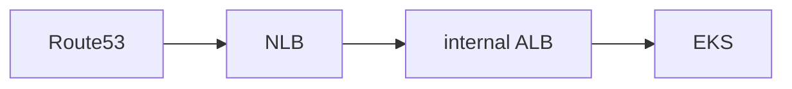
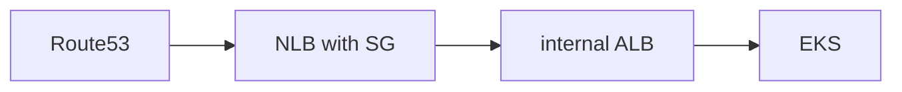

# NLB

## はじめに

本サイトにつきまして、[【IT技術の知見】はじめに - 俺の技術ノート](https://hiroki-it.github.io/tech-notebook/) をご認識のほど宜しくお願いいたします。

<br>

## 01. 概要

クラウド `L4` ロードバランサーとして働く。

<br>

## 02. 仕組み

固定 IP アドレスを設定できる。

そのため、ドメインを指定できず、IP アドレスを指定しないといけない HTTP リクエストを送信できないような通信元にも対応している。

この場合、NLB で受信した HTTP リクエストを ALB（internal タイプ）へ送信するようにするとよい。



<br>

## 03. セットアップ

### Terraformによる構築

terraform-aws-modules の ALB モジュールを使用し、固定 IP アドレスで受信した HTTPS 通信を内部 ALB へ転送する NLB を作成する。

同じアカウント・VPC 内にある既存の ALB とそのセキュリティグループ、異なる AZ のパブリックサブネット、各サブネットに割り当てる Elastic IP の割り当て ID を指定する。

ALB には HTTPS の 443 番ポートのリスナーを設定し、`/health` へのヘルスチェックに成功するターゲットを登録しておく。

NLB は TCP のまま転送し、TLS は ALB で終端する。

```terraform
module "nlb" {
  source  = "terraform-aws-modules/alb/aws"
  version = "10.5.1"

  name               = "foo-nlb"
  load_balancer_type = "network"
  vpc_id             = "vpc-0123456789abcdef0"

  subnet_mapping = [
    {
      subnet_id     = "subnet-0123456789abcdef0"
      allocation_id = "eipalloc-0123456789abcdef0"
    },
    {
      subnet_id     = "subnet-0123456789abcdef1"
      allocation_id = "eipalloc-0123456789abcdef1"
    }
  ]

  security_group_ingress_rules = {
    https = {
      from_port = 443
      to_port   = 443
      cidr_ipv4 = "203.0.113.0/24"
    }
  }

  security_group_egress_rules = {
    alb = {
      from_port                    = 443
      to_port                      = 443
      referenced_security_group_id = "sg-0123456789abcdef0"
    }
  }

  listeners = {
    https = {
      port     = 443
      protocol = "TCP"
      forward = {
        target_group_key = "alb"
      }
    }
  }

  target_groups = {
    alb = {
      port        = 443
      protocol    = "TCP"
      target_type = "alb"
      target_id   = "arn:aws:elasticloadbalancing:ap-northeast-1:123456789012:loadbalancer/app/foo-internal-alb/0123456789abcdef"
      health_check = {
        protocol = "HTTPS"
        path     = "/health"
      }
    }
  }
}

resource "aws_vpc_security_group_ingress_rule" "alb_from_nlb" {
  security_group_id            = "sg-0123456789abcdef0"
  referenced_security_group_id = module.nlb.security_group_id
  from_port                    = 443
  to_port                      = 443
  ip_protocol                  = "tcp"
}
```

> - [terraform-aws-modules/alb/aws (10.5.1) - Terraform Registry](https://registry.terraform.io/modules/terraform-aws-modules/alb/aws/10.5.1)
> - [Use an Application Load Balancer as a target of a Network Load Balancer - Elastic Load Balancing](https://docs.aws.amazon.com/elasticloadbalancing/latest/network/application-load-balancer-target.html)

<br>

## 04. NLB の通信制御

### L3/L4 防御

Amazon EC2 Security Group をアタッチし、L3/L4（IP アドレス、プロトコル、ポート番号） を防御する。



<br>
