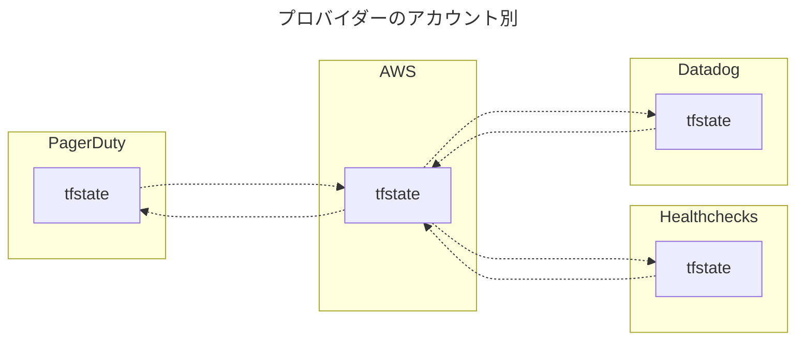
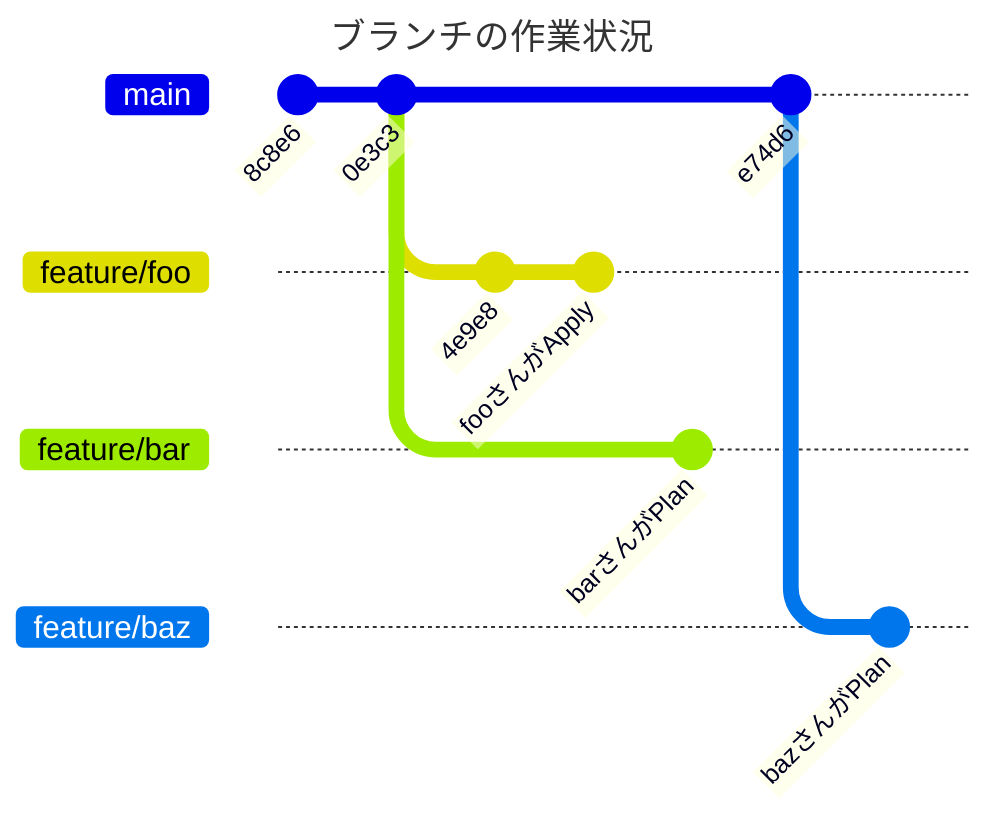
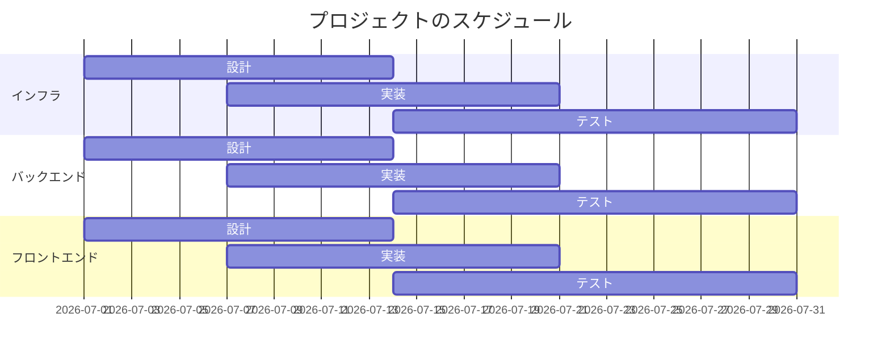

# マーメイド＠開発手法

### はじめに

本サイトにつきまして、[【IT技術の知見】はじめに - 俺の技術ノート](https://hiroki-it.github.io/tech-notebook/) をご認識のほど宜しくお願いいたします。

 

## フローチャート

Terraform の tfstate をプロバイダーのアカウント別に分割し、tfstate 同士が互いに参照し合う関係を点線の矢印で表すフローチャートの例である。

> - [Flowcharts Syntax \| Mermaid](https://mermaid.js.org/syntax/flowchart.html?id=flowcharts-basic-syntax)

 

## Git グラフ

ブランチごとに誰が Plan や Apply を実行したかを、コミットのラベルで表す Git グラフの例である。

> - [GitGraph Diagrams \| Mermaid](https://mermaid.js.org/syntax/gitgraph.html)

 

## ガントチャート

インフラ、バックエンド、フロントエンドの設計、実装、テストの期間が重なる様子を日付で表すガントチャートの例である。

> - [Gantt diagrams \| Mermaid](https://mermaid.js.org/syntax/gantt.html)

 
