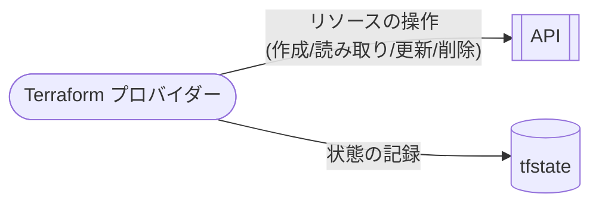
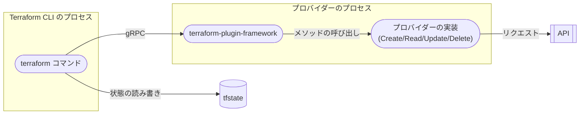
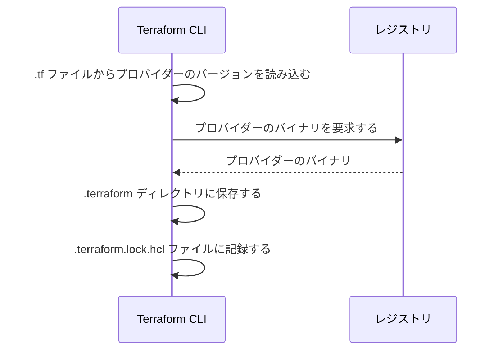
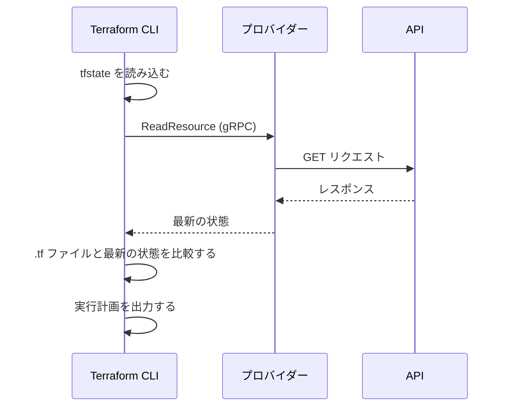
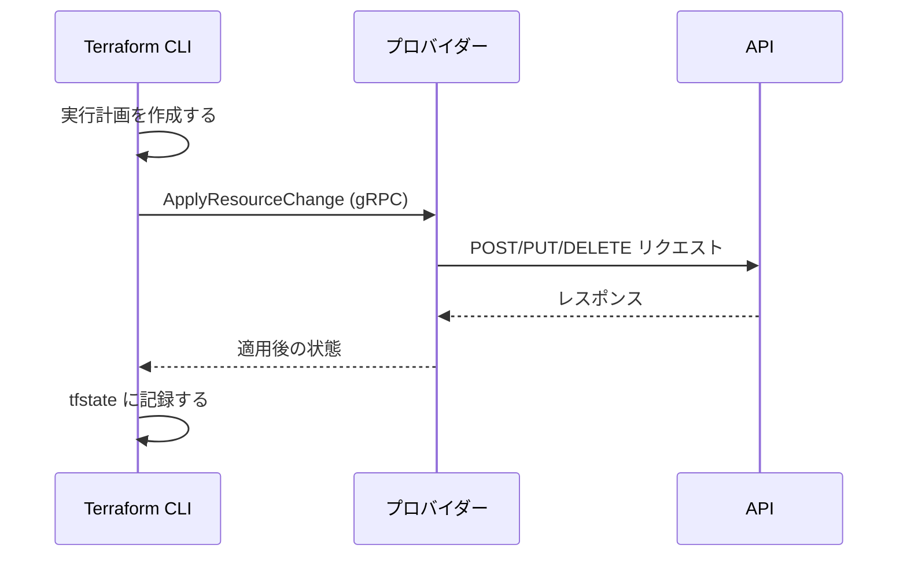

# 内製プロバイダー

## はじめに

本サイトにつきまして、[【IT技術の知見】はじめに - 俺の技術ノート](https://hiroki-it.github.io/tech-notebook/) をご認識のほど宜しくお願いいたします。

<br>

## 内製プロバイダーの仕組み

### アーキテクチャ

#### ▼ 概要

Terraform プロバイダーは、API にリクエストを送信してリソースを操作 (作成/読み取り/更新/削除) し、その結果を tfstate に記録する。

`terraform plan` コマンドでは、プロバイダーが API からリソースを読み取って tfstate を更新し、Terraform が `.tf` ファイルと比較して差分を出力する。



#### ▼ Terraform CLI とプロバイダーの関係

Terraform CLI (`terraform` コマンドのバイナリ) は、プロバイダーを別のプロセスとして起動し、gRPC でリソースの操作を依頼する。

プロバイダーは、`terraform-plugin-framework` パッケージで gRPC の通信を受け、Create/Read/Update/Delete の各メソッドを実行する。

| 担当                                    | 役割                                                                 |
| --------------------------------------- | -------------------------------------------------------------------- |
| Terraform CLI                           | `.tf` ファイルの解釈、tfstate の読み書き、実行計画の作成、差分の出力 |
| `terraform-plugin-framework` パッケージ | Terraform CLI との gRPC の通信、各メソッドの呼び出し                 |
| プロバイダーの実装                      | API へのリクエスト、レスポンスからリソースの状態への変換             |



> - [Terraform Plugin Protocol | Terraform | HashiCorp Developer](https://developer.hashicorp.com/terraform/plugin/terraform-plugin-protocol)
> - [Terraform Plugin Framework | Terraform | HashiCorp Developer](https://developer.hashicorp.com/terraform/plugin/framework)

<br>

### 処理の流れ

#### ▼ `terraform init` コマンド

`terraform init` コマンドを実行すると、Terraform CLI はレジストリからプロバイダーのバイナリをダウンロードし、`.terraform.lock.hcl` ファイルにバージョンを記録する。



#### ▼ `terraform plan` コマンド

`terraform plan` コマンドを実行すると、Terraform CLI はプロバイダーの Read で最新の状態を取得し、`.tf` ファイルと比較して実行計画を作成する。



#### ▼ `terraform apply` コマンド

`terraform apply` コマンドを実行すると、Terraform CLI は実行計画にもとづいてプロバイダーの Create/Update/Delete を呼び出し、適用後の状態を tfstate に記録する。



<br>

## 最小限のプロバイダー実装

Terraform Plugin Framework を使用すると、Go で内製プロバイダーを実装できる。

```go
package provider

import (
	"context"
	"github.com/hashicorp/terraform-plugin-framework/datasource"
	"github.com/hashicorp/terraform-plugin-framework/provider"
	providerschema "github.com/hashicorp/terraform-plugin-framework/provider/schema"
	"github.com/hashicorp/terraform-plugin-framework/resource"
)

type exampleProvider struct{}

func (p *exampleProvider) Metadata(
	_ context.Context,
	_ provider.MetadataRequest,
	resp *provider.MetadataResponse,
) {
	// fooリソースを定義する
	resp.TypeName = "foo"
}

func (p *exampleProvider) Schema(
	_ context.Context,
	_ provider.SchemaRequest,
	resp *provider.SchemaResponse,
) {
	resp.Schema = providerschema.Schema{}
}

func (p *exampleProvider) Configure(
	context.Context,
	provider.ConfigureRequest,
	*provider.ConfigureResponse,
) {
}

func (p *exampleProvider) Resources(context.Context) []func() resource.Resource {
	return []func() resource.Resource{
		func() resource.Resource { return &fooResource{} },
	}
}

func (p *exampleProvider) DataSources(context.Context) []func() datasource.DataSource {
	return []func() datasource.DataSource{
		func() datasource.DataSource { return &barDataSource{} },
	}
}

func New() provider.Provider {
	return &exampleProvider{}
}
```

## 最小限のResource

Resource は、Terraform で作成、読み取り、更新、削除する対象を表す。

次のような `resource` を定義するための Data Source を実装する。

```terraform
resource "foo_bar" "this" {}
```

```go
package provider

import (
	"context"
	"github.com/hashicorp/terraform-plugin-framework/resource"
	"github.com/hashicorp/terraform-plugin-framework/resource/schema"
	"github.com/hashicorp/terraform-plugin-framework/types"
)

type fooResource struct{}

type fooResourceModel struct {
	ID types.String `tfsdk:"id"`
}

func (r *fooResource) Metadata(
	_ context.Context,
	req resource.MetadataRequest,
	resp *resource.MetadataResponse,
) {
	// barタイプを定義する
	// fooリソースはプロバイダーのMetadataで定義している
	// resource "foo_bar" になる
	resp.TypeName = req.ProviderTypeName + "_bar"
}

func (r *fooResource) Schema(
	_ context.Context,
	_ resource.SchemaRequest,
	resp *resource.SchemaResponse,
) {
	resp.Schema = schema.Schema{
		Attributes: map[string]schema.Attribute{
			"id": schema.StringAttribute{Computed: true},
		},
	}
}

func (r *fooResource) Create(
	ctx context.Context,
	_ resource.CreateRequest,
	resp *resource.CreateResponse,
) {
	resp.Diagnostics.Append(resp.State.Set(ctx, &fooResourceModel{
		ID: types.StringValue("example-id"),
	})...)
}

func (r *fooResource) Read(
	context.Context,
	resource.ReadRequest,
	*resource.ReadResponse,
) {
}

func (r *fooResource) Update(
	context.Context,
	resource.UpdateRequest,
	*resource.UpdateResponse,
) {
}

func (r *fooResource) Delete(
	ctx context.Context,
	_ resource.DeleteRequest,
	resp *resource.DeleteResponse,
) {
	resp.State.RemoveResource(ctx)
}
```

## 最小限のData Source

Data Source は、既存の情報を読み取って State に保存する。

次のような `data` を定義するための Data Source を実装する。

```terraform
data "foo_bar" "this" {}
```

```go
package provider

import (
	"context"
	"github.com/hashicorp/terraform-plugin-framework/datasource"
	"github.com/hashicorp/terraform-plugin-framework/datasource/schema"
	"github.com/hashicorp/terraform-plugin-framework/types"
)

type barDataSource struct{}

type barDataSourceModel struct {
	Message types.String `tfsdk:"message"`
}

func (d *barDataSource) Metadata(
	_ context.Context,
	req datasource.MetadataRequest,
	resp *datasource.MetadataResponse,
) {
	// barタイプを定義する
	// fooリソースはプロバイダーのMetadataで定義している
	// data "foo_bar" になる
	resp.TypeName = req.ProviderTypeName + "_bar"
}

func (d *barDataSource) Schema(
	_ context.Context,
	_ datasource.SchemaRequest,
	resp *datasource.SchemaResponse,
) {
	resp.Schema = schema.Schema{
		Attributes: map[string]schema.Attribute{
			"message": schema.StringAttribute{Computed: true},
		},
	}
}

func (d *barDataSource) Read(
	ctx context.Context,
	_ datasource.ReadRequest,
	resp *datasource.ReadResponse,
) {
	resp.Diagnostics.Append(resp.State.Set(ctx, &barDataSourceModel{
		Message: types.StringValue("Hello, Terraform!"),
	})...)
}
```

## 受け入れテスト

Go 標準の `testing` パッケージと `terraform-plugin-testing` を組み合わせ、Terraform Provider の受け入れテストを実装する。

受け入れテストは、次のように `TF_ACC=1` を設定する必要がある。

```bash
TF_ACC=1 go test ./internal/provider/... -v
```

```go
package provider_test

import (
	"testing"
	"github.com/hashicorp/terraform-plugin-framework/providerserver"
	"github.com/hashicorp/terraform-plugin-go/tfprotov6"
	"github.com/hashicorp/terraform-plugin-testing/helper/resource"
	exampleprovider "example.com/example/internal/provider"
)

var testProviderFactories = map[string]func() (tfprotov6.ProviderServer, error){
	"foo": providerserver.NewProtocol6WithError(exampleprovider.New()),
}

func TestAccProvider(t *testing.T) {
	resource.Test(t, resource.TestCase{
		ProtoV6ProviderFactories: testProviderFactories,
		Steps: []resource.TestStep{
			{
				Config: `
terraform {
  required_providers {
    foo = {
      source = "example.com/example/example"
    }
  }
}

resource "foo_bar" "this" {}

data "foo_bar" "this" {}
`,
				Check: resource.ComposeAggregateTestCheckFunc(
					resource.TestCheckResourceAttr(
						"foo_bar.this", "id", "example-id",
					),
					resource.TestCheckResourceAttr(
						"data.foo_bar.this", "message", "Hello, Terraform!",
					),
				),
			},
		},
	})
}
```
