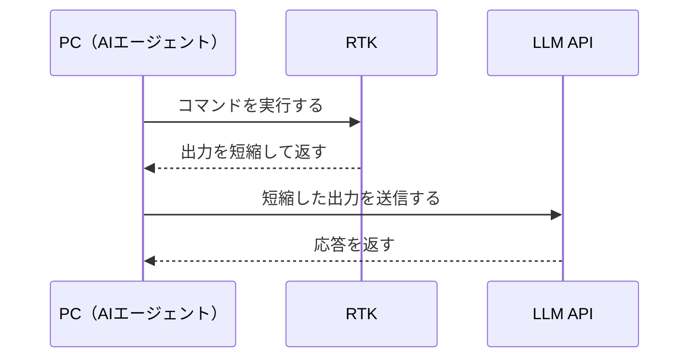
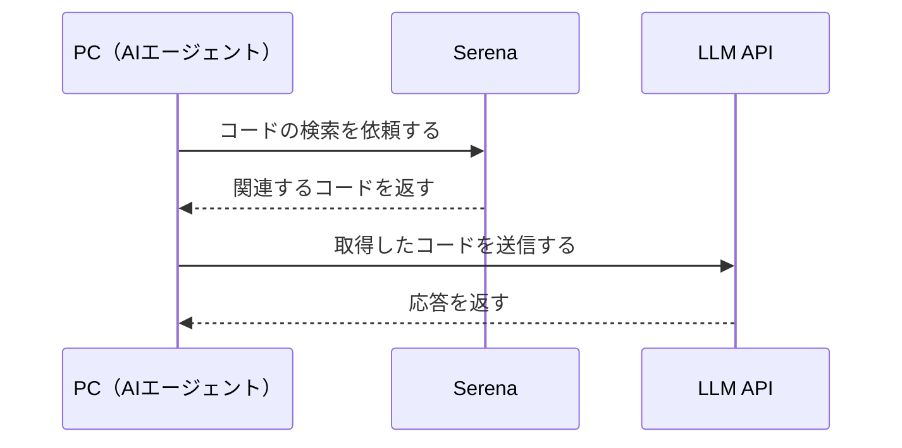
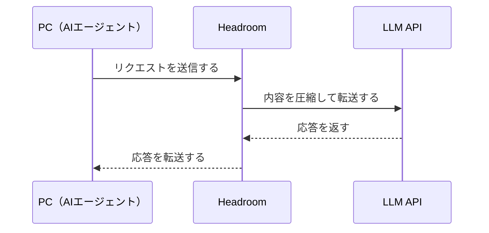

# トークン節約ツール

## はじめに

本サイトにつきまして、[【IT技術の知見】はじめに - 俺の技術ノート](https://hiroki-it.github.io/tech-notebook/) をご認識のほど宜しくお願いいたします。

<br>

## 01. RTK

### RTKとは

RTK は、対応するコマンドの出力を短縮し、AI エージェントに渡す入力トークン量を節約して、利用料を抑えるツールである。

MCP サーバーではなく、フックを通じて対応するコマンドを RTK 経由に書き換える。



> - [GitHub - rtk-ai/rtk: CLI proxy that reduces LLM token consumption by 60-90% on common dev commands. Single Rust binary, zero dependencies · GitHub](https://github.com/rtk-ai/rtk)

### セットアップ

macOS で Homebrew を使用する場合、次のようにインストールする。

```bash
$ brew install rtk

# Codexにフックを設定する
$ rtk init --global --codex

# Claude Codeにフックを設定する
$ rtk init --global
```

設定後は各エージェントを再起動する。

`rtk init --global` は Claude Code の設定である。

導入状況や節約量は次のコマンドで確認できる。

```bash
$ rtk init --show
$ rtk gain
```

`rtk gain` の節約量は推定値であり、対象外のコマンドや画像の確認には適用されない。

### 設定ファイル

macOS では `~/Library/Application Support/rtk/config.toml` を使用する。

ファイルがなくてもデフォルト設定で動作する。

設定を作成または確認するときは、次のコマンドを使用する。

```bash
$ rtk config --create
$ rtk config
```

代表的な設定例を次に示す。

```toml
[tracking]
enabled = true # 節約量の記録を有効にする
history_days = 90 # 記録を保持する日数

[retriever]
mode = "sqlite" # 元の出力の保存方式：sqlite、tee、disabled
retention_days = 30 # sqliteで保存した出力を保持する日数

[telemetry]
enabled = false # 匿名の利用状況送信を無効にする

[hooks]
exclude_commands = [] # 自動変換の対象外にするコマンド

[limits]
grep_max_results = 200 # 検索結果の表示件数の上限
status_max_files = 15 # git statusのファイル表示件数の上限
```

> - [Configuration \| RTK](https://www.rtk-ai.app/docs/getting-started/configuration/)

<br>

## 02. Serena

### Serenaとは

Serena は、MCP を介して必要なコードを検索することで、AI エージェントに渡す入力トークン量を節約し、利用料を抑えるツールである。



> - [GitHub - oraios/serena: A powerful MCP toolkit for coding, providing semantic retrieval and editing capabilities - the IDE for your agent · GitHub](https://github.com/oraios/serena)

### セットアップ

uv をインストールしたうえで、次のコマンドを実行する。

```bash
$ uv tool install -p 3.13 serena-agent
$ serena init

# CodexにMCPサーバーを登録する
$ serena setup codex

# Claude CodeにMCPサーバーを登録する
$ serena setup claude-code
```

設定後は各エージェントを再起動する。

登録内容は `codex mcp get serena` または `claude mcp get serena` で確認できる。

作業対象が自動的に有効化されない場合は、Serena で現在のディレクトリをプロジェクトとして有効化するようエージェントに依頼する。

> - [Installation \| uv](https://docs.astral.sh/uv/getting-started/installation/)

### 設定ファイル

グローバル設定は `~/.serena/serena_config.yml` に保存され、各プロジェクトに適用される。

代表的な設定例を次に示す。

```yaml
# 言語サーバーを使用する
language_backend: LSP

# エージェントに提供するインターフェース：tools または REPL
agent_interface: REPL

# ブラウザ用ダッシュボードを有効にする
web_dashboard: true

# GUIログウィンドウを無効にする
gui_log_window: false

# ツールの回答に使用する文字数のデフォルト上限
default_max_tool_answer_chars: 150000

# すべてのプロジェクトで除外するパス
ignored_paths: []

# プロジェクトごとの設定、キャッシュ、メモリーをホームディレクトリに置く
project_serena_folder_location: "/Users/hiroki.hasegawa/.serena/projects$projectDir/.serena"
```

> - [Configuration — Serena Documentation](https://oraios.github.io/serena/02-usage/050_configuration.html)

<br>

## 03. Headroom

### Headroomとは

Headroom は、AI エージェントと LLM の間で動作し、ツールの実行結果やログなどを圧縮して入力トークン量を節約し、利用料を抑えるツールである。

ローカルプロキシを介してリクエストを転送し、必要に応じて圧縮前の内容を MCP ツールから取得できる。



> - [GitHub - headroomlabs-ai/headroom](https://github.com/headroomlabs-ai/headroom)

### セットアップ

uv をインストールしたうえで、次のコマンドを実行する。

```bash
$ uv tool install --python 3.13 "headroom-ai[all]"
```

常駐プロキシを設定し、エージェントの接続先をローカルプロキシに変更する。

Claude Code と Codex で使用する常駐プロキシを、次のように設定する。

LiteLLM の URL は実際の接続先に置き換える。

```bash
$ headroom install apply --providers manual --target claude --target codex \
    --runtime python --no-rate-limit \
    --env ANTHROPIC_TARGET_API_URL=https://litellm.example.com \
    --env OPENAI_TARGET_API_URL=https://litellm.example.com
```

Claude Code の `~/.claude/settings.json` の既存の `env` に `ANTHROPIC_BASE_URL` を設定する。

```json
{
  "env": {
    "ANTHROPIC_BASE_URL": "http://127.0.0.1:8787"
  }
}
```

Codex の `~/.codex/config.toml` で使用中のプロバイダーの `base_url` を設定する。

次はプロバイダー名が `lite_llm` の例である。

```toml
[model_providers.lite_llm]
base_url = "http://127.0.0.1:8787/v1"
```

初回設定後は各エージェントを再起動する。

稼働状況と接続先は次のコマンドで確認できる。

```bash
$ headroom install status
$ headroom doctor
```

> - [Persistent installs | Headroom](https://docs.headroomlabs.ai/docs/persistent-installs)
