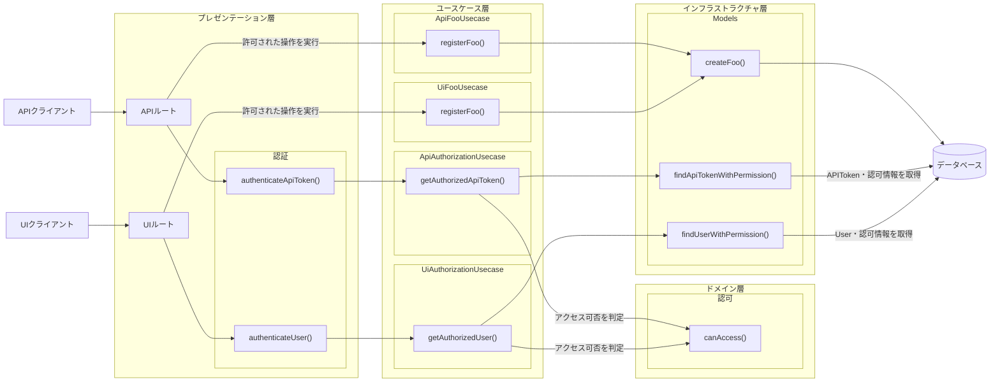

# 認可

## はじめに

本サイトにつきまして、[【IT技術の知見】はじめに - 俺の技術ノート](https://hiroki-it.github.io/tech-notebook/) をご認識のほど宜しくお願いいたします。

 

## 01. 認可とは

認証済みのユーザーのリクエストに応じてリソース操作を実施し (Enforcement) 、認可スコープに基づいて許否を決定します (Decision) 。

基本的に、認可の実装は認証に依存する。

> - [Authorization Academy - What is Authorization?](https://www.osohq.com/academy/what-is-authorization)
> - [よくわかる認証と認可 \| DevelopersIO](https://dev.classmethod.jp/articles/authentication-and-authorization/#toc-2)

 

## 02. アプリケーションで実装する場合

### アプリケーションで実装する場合とは

アプリケーションで、認可処理を実装する。

クリーンアーキテクチャであれば、ドメインサービスやアプリケーションサービスである。

 

### 層ごとの配置

レイヤードアーキテクチャのアプリケーションで、認可処理を担うコンポーネントと、その層を示す。

認証処理はプレゼンテーション層に置き、UserやAPIトークンの認可情報の取得と認可の判定の組み立てはユースケース層に置く。

認可の判定ルールはドメイン層に置く。

 

### エンドポイントの分割

テナントが存在するアプリケーションで、テナント横断的な管理者ロールとそれ以外のロールを定義する場合を考える。

管理者ロールでは操作できるデータが横断的になる。

管理者ロールとそれ以外の認可ロジックを一緒にすると複雑になるため、管理者エンドポイントを別に定義しつつ、管理者用の認可ロジックは切り分けることが適切である。

<table>
  <thead>
    <tr>
      <th></th>
      <th>テナント横断的な管理者ロール</th>
      <th>各テナントのロール</th>
    </tr>
  </thead>
  <tbody>
    <tr>
      <td>GET</td>
      <td>・<code>/admin/organizations/{orgId}/orders</code> ・<code>/admin/organizations/{orgId}/orders/{id}</code></td>
      <td>・<code>/orders</code> ・<code>/orders/{id}</code></td>
    </tr>
    <tr>
      <td>POST</td>
      <td><code>/admin/organizations/{orgId}/orders</code></td>
      <td><code>/orders</code></td>
    </tr>
    <tr>
      <td>PUT</td>
      <td><code>/admin/organizations/{orgId}/orders/{id}</code></td>
      <td><code>/orders/{id}</code></td>
    </tr>
    <tr>
      <td>DELETE</td>
      <td><code>/admin/organizations/{orgId}/orders/{id}</code></td>
      <td><code>/orders/{id}</code></td>
    </tr>
  </tbody>
</table>

 

## 03. 委譲する場合

### 委譲する場合とは

認可処理を実行してくれるツール (例：Open Policy Agent など) に委譲する。

 
