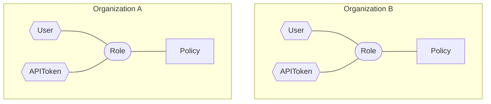
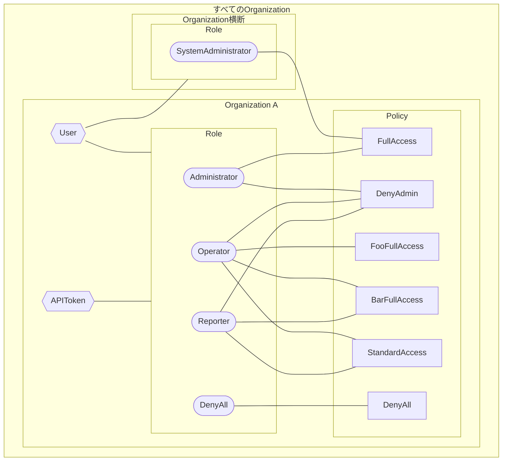
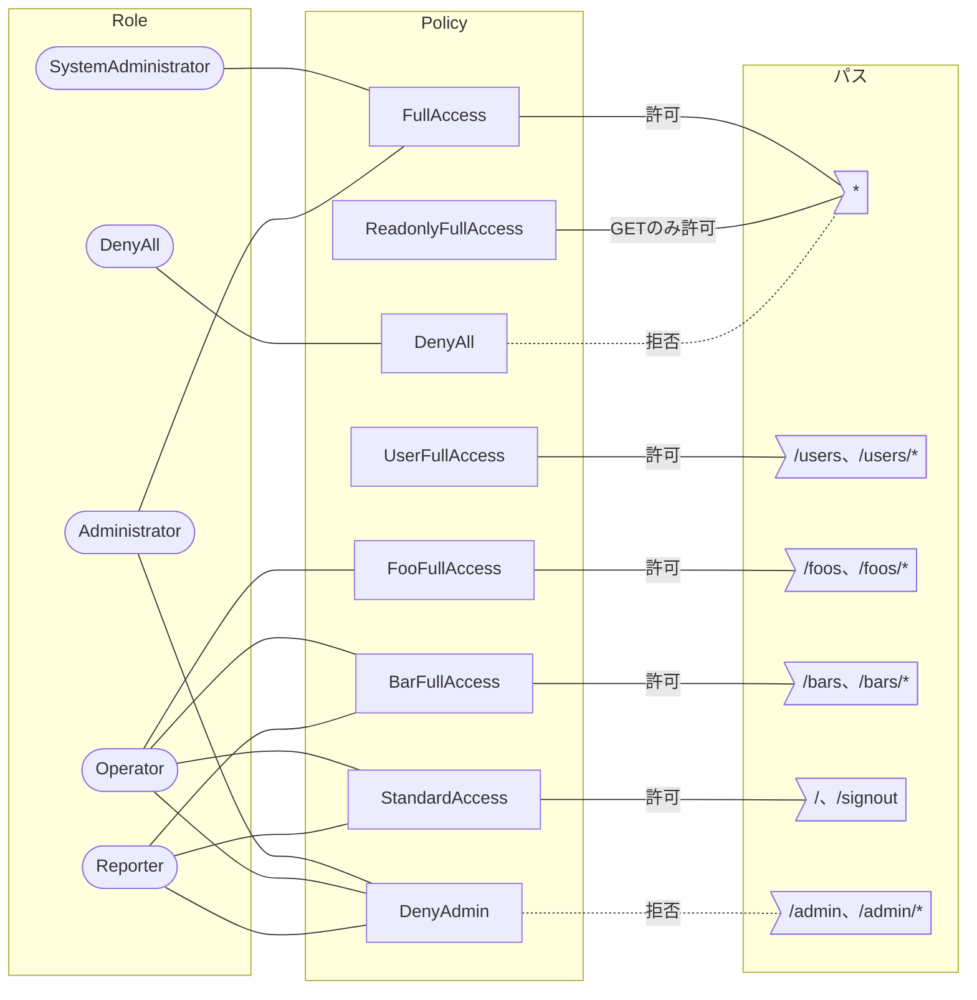

# RBAC

## はじめに

本サイトにつきまして、[【IT技術の知見】はじめに - 俺の技術ノート](https://hiroki-it.github.io/tech-notebook/) をご認識のほど宜しくお願いいたします。

 

## 01. RBACとは

ロールベースアクセス制御（RBAC）では、UserにRoleを割り当て、Roleに紐づくPolicyによって実行できる操作を制御する。

マルチテナントの場合、Organization（テナント）はUserやRoleを管理する単位になる。

APIトークンを使ってアクセスする場合は、Userの代わりにAPIトークンにRoleを割り当て、同様に操作を制御する。

 

## 02. OrganizationとRoleとPolicyの関係

Roleは複数のPolicyを持つ。

各Policyが認可スコープの部品であり、Roleの認可スコープはそれらの部品を組み合わせたものになる。

ただし、拒否するPolicyの認可スコープは、Roleの認可スコープから除かれる。

テナントを横断してシステム全体を管理するRoleは、各Organizationの外に置く。

以下は、Roleに割り当てるPolicyの例である。

| Role                | 割り当てられているPolicy                                  |
| ------------------- | -------------------------------------------------------- |
| SystemAdministrator | FullAccess                                               |
| Administrator       | FullAccess、DenyAdmin                                    |
| Operator            | FooFullAccess、BarFullAccess、StandardAccess、DenyAdmin  |
| Reporter            | BarFullAccess、StandardAccess、DenyAdmin                 |
| DenyAll             | DenyAll                                                  |

 

## 03. Policyと認可スコープの関係

Policyは、認可スコープを組み立てるための部品である。

1つのPolicyは、特定のパスとHTTPメソッドへのアクセスを許可（`ALLOW`）または拒否（`DENY`）する。

以下は、Policyの例である。

| Policy             | 操作対象                       | 許可／拒否  | パス                 |
| ------------------ | ------------------------------ | ----------- | -------------------- |
| FullAccess         | すべて                         | 許可        | `*`                  |
| ReadonlyFullAccess | すべて                         | GETのみ許可 | `*`                  |
| UserFullAccess     | ユーザーのみ                   | 許可        | `/users`、`/users/*` |
| FooFullAccess      | Fooのみ                        | 許可        | `/foos`、`/foos/*`   |
| BarFullAccess      | Barのみ                        | 許可        | `/bars`、`/bars/*`   |
| StandardAccess     | トップページとサインアウトのみ | 許可        | `/`、`/signout`      |
| DenyAll            | すべて                         | 拒否        | `*`                  |
| DenyAdmin          | システム管理                   | 拒否        | `/admin`、`/admin/*` |

 

## 04. Policyを組み合わせたRoleの認可スコープ

リクエストのアクセスの可否は、次の順番で判定する。

1. Roleが持つPolicyの中から、リクエストのパスとHTTPメソッドに当てはまるものを探す
2. 当てはまるPolicyが1つもなければ、拒否する
3. 当てはまるPolicyに`DENY`が1つでもあれば、拒否する
4. 当てはまるPolicyがすべて`ALLOW`であれば、許可する

例のPolicyはすべてのHTTPメソッドを対象にしているため、パスごとの可否を示す。

| パス ＼ Role         | SystemAdministrator | Administrator | Operator | Reporter | DenyAll |
| -------------------- | ------------------- | ------------- | -------- | -------- | ------- |
| `/`、`/signout`      | 許可                | 許可          | 許可     | 許可     |         |
| `/foos`、`/foos/*`   | 許可                | 許可          | 許可     |          |         |
| `/bars`、`/bars/*`   | 許可                | 許可          | 許可     | 許可     |         |
| `/users`、`/users/*` | 許可                | 許可          |          |          |         |
| `/admin`、`/admin/*` | 許可                |               |          |          |         |
| そのほかのすべてのパス | 許可              | 許可          |          |          |         |

 
