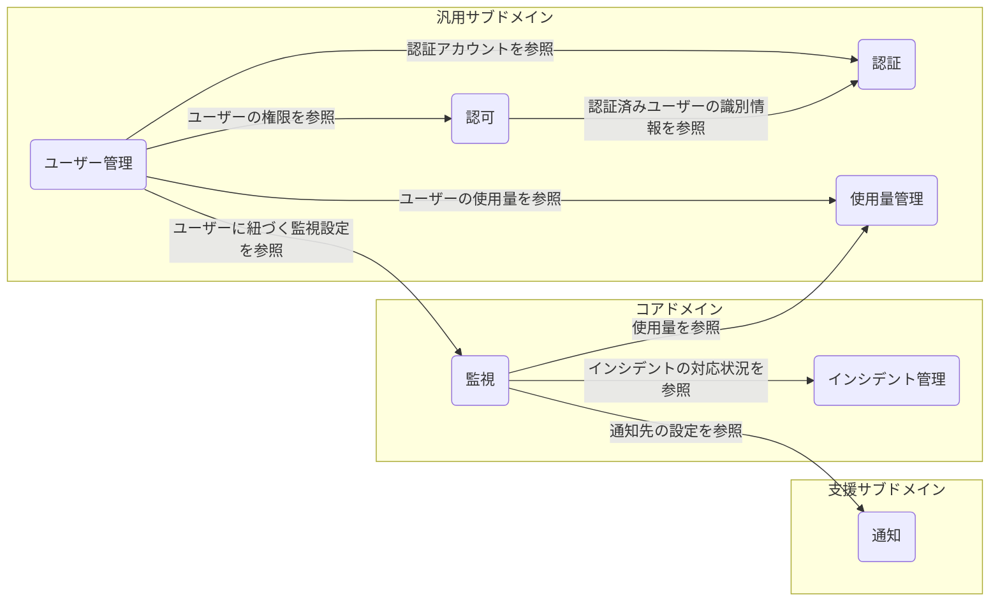
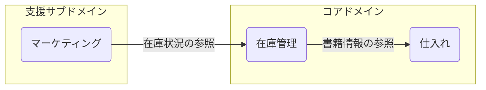
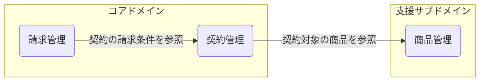
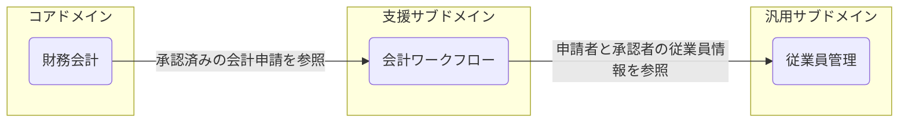
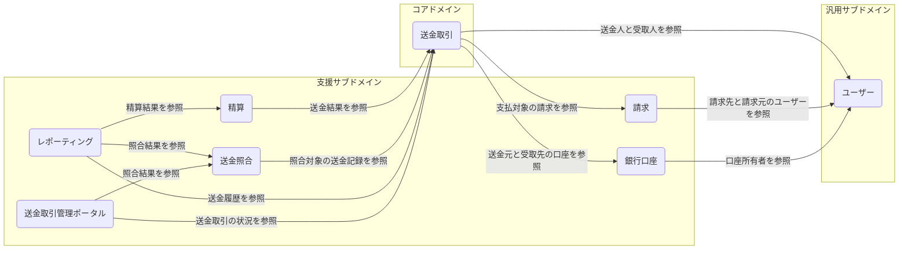
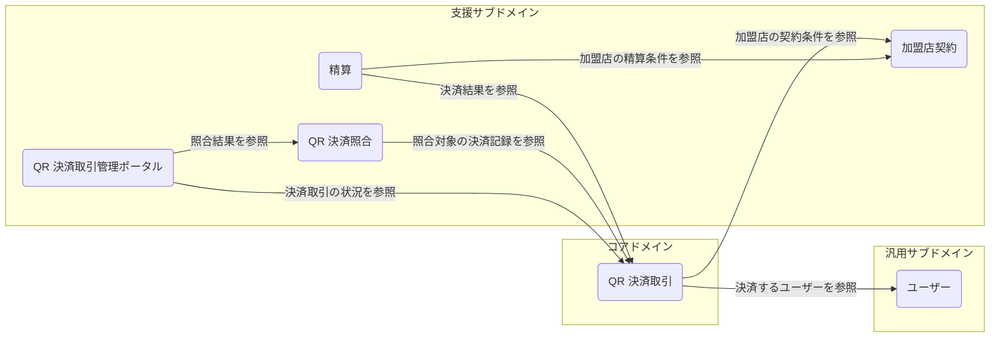

# ドメイン駆動設計＠アーキテクチャ

## はじめに

本サイトにつきまして、以下をご認識のほど宜しくお願いいたします。

> - [【IT技術の知見】はじめに - 俺の技術ノート](https://hiroki-it.github.io/tech-notebook/)

<br>

## 01. ドメイン駆動設計とは

オブジェクト指向分析設計から派生した分析設計の手法の一種。

オブジェクト指向分析設計のベタープラクティスを集め、より強化するために提唱された。

特に機能要件の多いアプリケーションに有効である。

必ずしもオブジェクト指向設計でドメイン駆動設計に沿う必要はなく、通常のオブジェクト指向分析設計をしても問題はない。

> - [\[ 技術講座 \] Domain-Driven Designのエッセンス 第1回｜オブジェクトの広場](https://www.ogis-ri.co.jp/otc/hiroba/technical/DDDEssence/chap1.html)
> - [ドメイン駆動設計 - Wikipedia](https://ja.wikipedia.org/wiki/%E3%83%89%E3%83%A1%E3%82%A4%E3%83%B3%E9%A7%86%E5%8B%95%E8%A8%AD%E8%A8%88)

<br>

## 02. ドメイン駆動設計の手順例

### 戦略的設計の手順例


戦略的設計では、ドメイン全体から境界づけられたコンテキストを明確にする。

`(1)`

: ドメインエキスパートと話し合い、ドメイン全体のなかからコアドメインとサブドメインを切り分ける。

`(2)`

: ドメインエキスパートの部署や業務フローの立ち位置によっては、同じ『名詞』や『動詞』であっても、意味合い/定義づけが異なる場合もある。その場合、それぞれを異なる名前からなるユビキタス言語として定義づける。

`(3)`

: ユビキタス言語を元に、境界づけられたコンテキストを定義づける。

`(4)`

: コンテキストマップを作成し、境界づけられたコンテキスト間の関係を明らかにする。

> - [DDDのドメイン・サブドメイン・ユビキタス言語・境界づけられたコンテキストを整理する #ドメイン駆動設計 - Qiita](https://qiita.com/crossroad0201/items/875c5f76ed3794ed56c4)

<br>

### 戦術的設計の手順例

戦術的設計では、境界づけられたコンテキストをアーキテクチャやデザインパターンに落とし込む。

ここでは、SUDO モデリングを採用するものとする。

`(1)`

: ドメインエキスパートと話し合いにドメインルールや振る舞いをヒアリングする。

`(2)`

: オブジェクトの具体化のためにユースケース図やオブジェクト図でオブジェクトを作成し、抽象化のためにドメインモデル図も作成する。

`(3)`

: 必要であればドメインエキスパートに再ヒアリングを行い、特にオブジェクト図とドメインモデル図を改善する。

`(4)`

: ドメインモデル図を元に、クラス図を作成する。このとき、モデルをエンティティや値オブジェクトを切り分けるようにする。

`(5)`

: アーキテクチャ (レイヤード型、ヘキサゴナル型、オニオン型、クリーンアーキテクチャ) を決め、クラス図を元にドメイン層を実装する。

`(6)`

: 運用後に問題が発生した場合、特にオブジェクト図とドメインモデル図を修正する。場合によっては、デザインパターンに切り分ける。

> - [ドメイン駆動設計 サンプルコード&FAQ - little-hands - BOOTH](https://booth.pm/ja/items/3363104)

<br>

## 03. 戦略的設計

### ドメイン

#### ▼ ドメインとは

ビジネスモデル全体で見たときに、ソフトウェア化の対象となる業務領域のこと。

#### ▼ ドメインの分割方法

業務領域を分割するときの粒度は小さいほどよい。

業務領域を細分化するうえで境目を見分ける方法として、会社の組織図から、部署ごとに担当する業務の種類を確認するとよい。

また、ビジネスモデルにおける一連の業務フローのなかで、業務担当者の属性が変化するタイミングに着目するとよい。

担当者が変われば、業務をより小さな単位で抽出できるはずである。例えば、コールセンター部 (電話対応業務、顧客管理業務) や法人営業部 (受注業務) がある。また、マーケティング部 (ユーザー集客業務、広告運用業務) や管理部 (会計業務、財務業務、採用業務) がある。

このときの注意点として、業務領域は、ToB や ToC に関わらないことである。

例えば、ToC なドメインには、マーケーティング部による業務 (ユーザー集客業務、広告運用業務) がある。

> - [前から疑問だったのですが、DDDってtoCのサービスでもうまく機能するのでしょうか？toCのサービスの場合、どのようにドメインエキスパートを探す、あるいは設定するのでしょうか。 · Issue #191 · little-hands/ddd-q-and-a · GitHub](https://github.com/little-hands/ddd-q-and-a/issues/191)

#### ▼ 例：インターネット広告代理店

インターネット広告代理店の例。

ビジネスモデルに基づく複数のドメインを以下に示す。

業務フローの担当者の変化として、まず問い合わせで注文を受けて広告アカウントを作成する『営業担当者』、制作した広告をアカウントに入稿する『制作担当者』、入稿された広告を運用して広告効果を高める『マーケティング担当者』、最後に広告の依頼者に料金を請求する『経理担当者』が挙げられる。

これにより、インターネット広告代理店のビジネスモデルは、各担当者に対応するドメインへ分割できる。


> - [ドメイン駆動設計(DDD)との格闘 - 広義のドメイン・狭義のドメインの理解 - FLINTERS Engineer's Blog](https://labs.septeni.co.jp/entry/2021/04/15/130000)

#### ▼ 例：完全個室ジムを運営するハコジム


完全個室ジムを運営するハコジムの例。

ビジネスモデルに基づく複数のドメインを以下に示す。

業務フローの担当者の変化として、まず個室ジムに適する物件を探す『物件担当者』、ジムのトレーナーを採用して会員に紹介する『採用担当者』、個室ジムの利用会員を獲得する『営業担当者』が挙げられる。

これにより、ハコジムのビジネスモデルは、各担当者に対応するドメインへ分割できる。


> - [24時間個室ジム・パーソナルトレーニングジム \| ハコジム](https://hacogym.jp/)
> - [実際の業務とDDD - スマートロック開発日誌 #2](https://zenn.dev/hsshss/articles/e11efefc7011ab)

#### ▼ 例：監視 SaaS

プラットフォームエンジニアリングでは、エンジニアの技術的な業務がドメインになる。

例えば、監視 SaaS では監視業務領域がドメインになる。

適切な監視手法の選択、適切な TCP/IP のプロトコルの選択、アラートの巡回が業務である。

#### ▼ 例：オンライン書店

- カタログ管理
- 在庫管理
- 顧客分析
- 決済管理

#### ▼ 例：病院システム

- 情報管理
- 予約管理

<br>

### コアドメイン、サブドメイン、ドメインエキスパート

#### ▼ コアドメイン、サブドメインとは


> - [DDDのドメイン・サブドメイン・ユビキタス言語・境界づけられたコンテキストを整理する #ドメイン駆動設計 - Qiita](https://qiita.com/crossroad0201/items/875c5f76ed3794ed56c4)
> - [ドメイン駆動設計(DDD)との格闘 - 広義のドメイン・狭義のドメインの理解 - FLINTERS Engineer's Blog](https://labs.septeni.co.jp/entry/2021/04/15/130000)

#### ▼ ドメインエキスパートとは

各ドメインのドメインエキスパートと、エンジニアが話し合いながら、ドメイン内の主要業務をコアドメイン、補助的な業務をサブドメインに分類する。

コアドメインやサブドメイン相当の業務に詳しい人 (アプリケーションの利用者本人、利用者の関心が高い人)
がドメインエキスパートになることが多い。

**＊具体例＊**

業務アプリケーションの開発では、ビジネス業務（決済、請求、送金など）がドメインになる。

実際にビジネス側の人がドメインエキスパートを担ってもよいが、プロジェクトマネージャーがドメインエキスパートになるほうが現実的である。

**＊具体例＊**

プラットフォームエンジニアリングでは、エンジニアの技術的な業務 (監視業務、セキュリティ対策など) がドメインになる。

そのため、プラットフォーム SaaS ではドメインエキスパートはエンジニア（SRE など）になる。

#### ▼ サブドメインの委譲

コアドメインのソフトウェアは内製である必要があるが、サブドメインのソフトウェアは外製/内製のいずれでも問題ない。

必要であれば、他の業務系パッケージや業務系 SaaS (例：決済代行のベリトランス、経理 SaaS のマネーフォワード、総務人事 SaaS のサイボウズなど) にドメインロジックを委譲し、その API をコールしてデータを取得するような設計でもよい。

ただ、コアドメインが外部に依存すると、その SaaS で障害が起こったときにコアドメインのシステムも停止する可能性があるため、注意が必要である。

> - [Medium](https://medium.com/nick-tune-tech-strategy-blog/core-domain-patterns-941f89446af5)
> - [Aligning organization and architecture with strategic DDD - Speaker Deck](https://speakerdeck.com/mploed/aligning-organization-and-architecture-with-strategic-ddd?slide=26)

#### ▼ 例：完全個室ジムを運営するハコジム

完全個室ジムを運営するハコジムの例。

ドメインのうちで、個室ジムドメインに基づくコアドメインとサブドメインを以下に示す。

コアドメインは予約ドメイン、それ以外はサブドメインとしている。


> - [24時間個室ジム・パーソナルトレーニングジム \| ハコジム](https://hacogym.jp/)
> - [実際の業務とDDD - スマートロック開発日誌 #2](https://zenn.dev/hsshss/articles/e11efefc7011ab)

**＊例＊**

EC サイトを運営するアスクルの例。

ドメインのうちで、個人向け販売ドメイン (サイト名は LOHACO) に基づくコアドメインとサブドメインを以下に示す。

配送/注文/商品/ユーザ管理/在庫/受注をそれぞれサブドメインとしている (コアドメインは明言されていない) 。

> - [実録！LOHACOにおけるDDDとCleanなArchitecture/DDD and Clean Architecture at LOHACO - Speaker Deck](https://speakerdeck.com/askul/ddd-and-clean-architecture-at-lohaco?slide=28)

<br>

### ユビキタス言語

#### ▼ ユビキタス言語とは

同じ境界づけられたコンテキスト内で `1` 個の意味合い/定義付けを持った『名詞』や『動詞』のこと。

ドメインエキスパート間で、特定の『名詞』や『動詞』の意味合い/定義づけが異なる場合、これを異なる名前からなるユビキタス言語として定義づける。


> - [ユビキタス言語についての知見を共有します #DDD - Qiita](https://qiita.com/kmdsbng/items/bf415afbeec239a7fd63)

#### ▼ ユビキタス言語を見つける議論フレームワーク

イベントストーミングを実施し、業務フローやそのなかでドメインイベントの名詞や動詞から、ユビキタス言語を見つける。

議論のなかで発生したドメインイベントを線で結ぶ。


Figma などのツールを使用して、画面ごとにドメインイベントをつなげ、フロントエンドやバックエンドの機能ロジックを設計していく。


> - https://www.amazon.co.jp/dp/483998820X

#### ▼ 抽出例

<table>
  <thead>
    <tr>
      <th>単語</th>
      <th>意味合い</th>
      <th>対応するドメインモデル</th>
    </tr>
  </thead>
  <tbody>
    <tr>
      <td>...</td>
      <td>...</td>
      <td>...</td>
    </tr>
    <tr>
      <td>...</td>
      <td>...</td>
      <td>...</td>
    </tr>
  </tbody>
</table>

> - [ユビキタス言語策定したらビジネス理解がめっちゃ捗った話](https://zenn.dev/leaner_dev/articles/20210922-ubiquitous-language?redirected=1)

<br>

### 境界づけられたコンテキスト

#### ▼ 境界づけられたコンテキストとは

ドメインエキスパートの業務フローの立ち位置が異なれば、同じ『名詞』や『動詞』であっても、異なる意味合い/定義づけのユビキタス言語が使用される。

異なるユビキタス言語を元にして、境界づけられたコンテキストを設定する。

このとき、ユビキタス言語は、他の境界づけられたコンテキストでは通じないものであればあるほどよい。

境界づけられたコンテキストそれぞれのユビキタス言語に合わせて、異なる名前でモデリングしていく。

境界づけられたコンテキストを定義しない場合、異なるユビキタス言語をコアドメインやサブドメイン間で共有することとなり、それぞれの関心に無関係なデータを保持することになってしまう。

#### ▼ 考え方

アプリケーションがモデリングしている業務フローを考えるとわかりやすい。

ビジネス全体のどの部分をアプリケーションにしているのかによるが、例えば Amazon で以下の登場人物がいるとする。

1. 受注管理する人は、商品ドメインモデルが持つ注文内容/値段に関する状態に関心がある。
2. 在庫管理する人は、商品ドメインモデルが持つ在庫数に関する状態に関心がある。
3. 発送管理する人は、商品ドメインモデルが持つ発送状況に関する状態に関心がある。
4. 請求管理する人は、商品ドメインモデルが持つ請求状況に関する状態に関心がある。
5. 仕入れ管理する人は、商品ドメインモデルが持つ仕入れ状況に関する状態に関心がある。

商品 (Item) というオブジェクトがあったときに、業務フローのなかで商品を扱う人の文脈 (コンテキスト) によって、商品ドメインモデルの持つ状態への関心が変わる。

ここでいう状態とは、具体的に商品ドメインモデルを実装したときにプロパティとしてオブジェクトに持たせている状態である。

上記の 1-4 は、同じ商品ドメインモデルに対して関心の内容が異なるので、境界づけられたコンテキストが異なるとみなしたほうがよい。

別々のマイクロサービスとして分割し、それぞれのマイクロサービス上で異なる商品ドメインモデルを定義し、異なる状態を持たせることになる。

反対にモノリスだと、1 つの商品ドメインモデルにコンテキスト関係なくすべての種類の状態を持たせて、すべてのコンテキストで再利用する。

**＊表＊**

各業務を別のマイクロサービスに分けた場合の設計例を示す。

<table>
  <thead>
    <tr>
      <th>境界づけられたコンテキスト名</th>
      <th>マイクロサービス名</th>
      <th>集約名</th>
      <th>集約内のエンティティ</th>
    </tr>
  </thead>
  <tbody>
    <tr>
      <td>受注管理</td>
      <td>ordering</td>
      <td>注文</td>
      <td>Order（注文）、OrderItem（注文明細）</td>
    </tr>
    <tr>
      <td>在庫管理</td>
      <td>inventory</td>
      <td>在庫</td>
      <td>Inventory（在庫）</td>
    </tr>
    <tr>
      <td>発送管理</td>
      <td>shipping</td>
      <td>発送</td>
      <td>Shipment（発送）、ShipmentItem（発送明細）</td>
    </tr>
    <tr>
      <td>請求管理</td>
      <td>billing</td>
      <td>請求</td>
      <td>Invoice（請求）、InvoiceItem（請求明細）</td>
    </tr>
    <tr>
      <td>仕入れ管理</td>
      <td>purchasing</td>
      <td>仕入れ</td>
      <td>PurchaseOrder（仕入れ注文）、PurchaseOrderItem（仕入れ明細）</td>
    </tr>
  </tbody>
</table>

> - [受注業務フローとは？改善方法やメリットも解説！ - ネクストエンジン｜ECの受注・在庫・出荷を自動化](https://next-engine.net/ec-blog/order-flow/)

#### ▼ 例：監視 SaaS

監視 SaaS の境界づけられたコンテキストを、コアドメイン、支援サブドメイン、汎用サブドメインに分類した例を示す。各ノードは境界づけられたコンテキストを表し、矢印は依存する側から依存先へ向ける。

監視は監視設定や SLO、インシデント管理はインシデントの起票から解決、通知はアラート通知連携を扱う。ユーザー管理、認証、認可、使用量管理はそれぞれ別のコンテキストとして定義する。

**＊表＊**

<table>
  <thead>
    <tr>
      <th>境界づけられたコンテキスト名</th>
      <th>マイクロサービス名</th>
      <th>集約名</th>
      <th>集約内のエンティティ</th>
    </tr>
  </thead>
  <tbody>
    <tr>
      <td>監視</td>
      <td>monitoring</td>
      <td>監視設定</td>
      <td>Monitor（監視設定）</td>
    </tr>
    <tr>
      <td>インシデント管理</td>
      <td>incident</td>
      <td>インシデント</td>
      <td>Incident（インシデント）、IncidentHistory（対応履歴）</td>
    </tr>
    <tr>
      <td>通知</td>
      <td>notification</td>
      <td>通知設定</td>
      <td>NotificationSetting（通知設定）、NotificationDestination（通知先）</td>
    </tr>
    <tr>
      <td>ユーザー管理</td>
      <td>user</td>
      <td>ユーザー</td>
      <td>User（ユーザー）</td>
    </tr>
    <tr>
      <td>認証</td>
      <td>authentication</td>
      <td>認証アカウント</td>
      <td>Account（認証アカウント）</td>
    </tr>
    <tr>
      <td>認可</td>
      <td>authorization</td>
      <td>ロール</td>
      <td>Role（ロール）、Permission（権限）</td>
    </tr>
    <tr>
      <td>使用量管理</td>
      <td>usage</td>
      <td>使用量</td>
      <td>Usage（使用量）</td>
    </tr>
  </tbody>
</table>



#### ▼ 例：書籍 EC サイト

書籍 EC サイトの例。

コアドメインとサブドメインに基づいたユビキタス言語と境界づけられたコンテキストを以下に示す。

書籍の品ぞろえと在庫管理を強みとするサイトを想定し、仕入れと在庫管理をコアドメイン、マーケティングを支援サブドメインに分類する。各ノードは境界づけられたコンテキストを表し、矢印は依存する側から依存先へ向ける。同じ書籍を扱っていても、業務ごとに異なるモデルとデータを持つ。

在庫管理は仕入れで扱う書籍情報を参照し、マーケティングは在庫状況を参照してクーポンの対象書籍を決める例とする。認証などの汎用サブドメインは、この図では省略する。

バイヤー (仕入れ) 部、マーケティング部、在庫管理部のドメインエキスパートは、『本 (商品) 』という名詞に対する意味合い/定義づけが異なる。

そのため、それぞれを『本』『クーポン』『在庫』というユビキタス言語として定義できる。モデル名/データ名は、それぞれのユビキタス言語へ合わせた名前になる。

例えば、マーケの境界づけられたコンテキストでは、モデル名は Coupon となる。また、割引期間データを保持する必要がある。一方で、仕入部や在庫部ではこのデータは不要である。

一方、書籍の ISBN はすべての境界づけられたコンテキストのモデルに必要なデータである。

境界づけられたコンテキストを定義しない場合、`1` 個の商品モデルがすべてのデータを保持することとなり、それぞれのドメインエキスパートが関心を持たないデータも保持することになってしまう。

**＊表＊**

<table>
  <thead>
    <tr>
      <th>境界づけられたコンテキスト名</th>
      <th>マイクロサービス名</th>
      <th>集約名</th>
      <th>集約内のエンティティ</th>
    </tr>
  </thead>
  <tbody>
    <tr>
      <td>仕入れ</td>
      <td>purchasing</td>
      <td>本</td>
      <td>Book（本）</td>
    </tr>
    <tr>
      <td>マーケティング</td>
      <td>marketing</td>
      <td>クーポン</td>
      <td>Coupon（クーポン）</td>
    </tr>
    <tr>
      <td>在庫管理</td>
      <td>inventory</td>
      <td>在庫</td>
      <td>Inventory（在庫）</td>
    </tr>
  </tbody>
</table>




> - https://kenta-kosugi.medium.com/%E3%83%9E%E3%82%A4%E3%82%AF%E3%83%AD%E3%82%B5%E3%83%BC%E3%83%93%E3%82%B9%E3%81%AE%E4%B8%8A%E6%89%8B%E3%81%AA%E5%88%86%E5%89%B2-ff5bb01d1062

書籍モデルの実装例は次のとおりである。

```typescript
/** カタログコンテキストの書籍モデル */
class Book {
  constructor(
    /** 書籍の一意の識別子 */
    public isbn: string,
    /** 書籍のタイトル */
    public title: string,
    /** 書籍の著者 */
    public author: string,
    /** 書籍の説明 */
    public description: string,
    /** 書籍の販売価格 */
    public price: number,
  ) {}
}
```

```typescript
/** 在庫コンテキストの書籍モデル */
class Book {
  constructor(
    /** 書籍の一意の識別子 */
    public isbn: string,
    /** 書籍のタイトル */
    public title: string,
    /** 書籍の在庫数 */
    public quantityAvailable: number,
    /** 保管場所 */
    public location: string,
    /** 書籍の在庫ステータス */
    public status: "IN_STOCK" | "OUT_OF_STOCK",
  ) {}
}
```

#### ▼ 例：完全個室ジムを運営するハコジム

完全個室ジムを運営するハコジムの例。

個室ジムドメインのコアドメインとサブドメインに基づく境界づけられたコンテキスト。

認証コンテキスト、予約コンテキスト、顧客管理コンテキスト、銀行支払いコンテキスト、クレジットカード支払いコンテキストがある。

**＊表＊**

以下のマイクロサービス名、集約名、エンティティ名は、上記のコンテキストに基づく説明用の設計例であり、実際のサービス構成や実装名を示すものではない。

<table>
  <thead>
    <tr>
      <th>境界づけられたコンテキスト名</th>
      <th>マイクロサービス名</th>
      <th>集約名</th>
      <th>集約内のエンティティ</th>
    </tr>
  </thead>
  <tbody>
    <tr>
      <td>認証</td>
      <td>authentication</td>
      <td>認証アカウント</td>
      <td>Account（認証アカウント）</td>
    </tr>
    <tr>
      <td>予約</td>
      <td>reservation</td>
      <td>予約</td>
      <td>Reservation（予約）</td>
    </tr>
    <tr>
      <td>顧客管理</td>
      <td>customer</td>
      <td>顧客</td>
      <td>Customer（顧客）</td>
    </tr>
    <tr>
      <td>銀行支払い</td>
      <td>bank-payment</td>
      <td>銀行支払い</td>
      <td>BankPayment（銀行支払い）</td>
    </tr>
    <tr>
      <td>クレジットカード支払い</td>
      <td>card-payment</td>
      <td>クレジットカード支払い</td>
      <td>CardPayment（クレジットカード支払い）</td>
    </tr>
  </tbody>
</table>


> - [24時間個室ジム・パーソナルトレーニングジム \| ハコジム](https://hacogym.jp/)
> - [実際の業務とDDD - スマートロック開発日誌 #2](https://zenn.dev/hsshss/articles/e11efefc7011ab)

#### ▼ 例：契約請求管理アプリケーションを提供するアルプ

契約請求管理アプリケーションを提供するアルプの例。

コアドメインとサブドメインに基づいたユビキタス言語と境界づけられたコンテキストを以下に示す。

契約管理コンテキスト、商品管理コンテキスト、請求管理コンテキストがある。

アルプでは、ユビキタス言語を定期的に認識合わせするために、週次でユビキタス言語を追加し、また定義を更新している。

**＊表＊**

以下のマイクロサービス名、集約名、エンティティ名は、上記のコンテキストに基づく説明用の設計例であり、実際のサービス構成や実装名を示すものではない。

<table>
  <thead>
    <tr>
      <th>境界づけられたコンテキスト名</th>
      <th>マイクロサービス名</th>
      <th>集約名</th>
      <th>集約内のエンティティ</th>
    </tr>
  </thead>
  <tbody>
    <tr>
      <td>契約管理</td>
      <td>contract</td>
      <td>契約</td>
      <td>Contract（契約）、ContractItem（契約明細）</td>
    </tr>
    <tr>
      <td>商品管理</td>
      <td>product</td>
      <td>商品</td>
      <td>Product（商品）</td>
    </tr>
    <tr>
      <td>請求管理</td>
      <td>billing</td>
      <td>請求</td>
      <td>Invoice（請求）、InvoiceItem（請求明細）</td>
    </tr>
  </tbody>
</table>

契約と請求の管理を強みとする設計例として、契約管理と請求管理をコアドメイン、商品管理を支援サブドメインに分類する。各ノードは境界づけられたコンテキストを表し、矢印は依存する側から依存先へ向ける。この分類と依存関係は説明用の例である。




> - [全社員ユビキタス言語で話す！？ドメイン勉強会レポート｜Scalebase株式会社](https://note.com/alpinc/n/nab47ab9273c6)
> - [Scalebase株式会社](https://thealp.co.jp/)

#### ▼ 例：会計アプリケーションを提供する freee

会計アプリケーションを提供する freee の例。

財務会計コンテキスト、会計ワークフローコンテキスト、従業員管理コンテキストがある。

以下のマイクロサービス名、集約名、エンティティ名は、上記のコンテキストに基づく説明用の設計例であり、実際のサービス構成や実装名を示すものではない。

<table>
  <thead>
    <tr>
      <th>境界づけられたコンテキスト名</th>
      <th>マイクロサービス名</th>
      <th>集約名</th>
      <th>集約内のエンティティ</th>
    </tr>
  </thead>
  <tbody>
    <tr>
      <td>財務会計</td>
      <td>accounting</td>
      <td>仕訳</td>
      <td>JournalEntry（仕訳）、JournalEntryLine（仕訳明細）</td>
    </tr>
    <tr>
      <td>会計ワークフロー</td>
      <td>accounting-workflow</td>
      <td>会計申請</td>
      <td>AccountingApplication（会計申請）、ApprovalStep（承認ステップ）</td>
    </tr>
    <tr>
      <td>従業員管理</td>
      <td>employee</td>
      <td>従業員</td>
      <td>Employee（従業員）</td>
    </tr>
  </tbody>
</table>

財務会計を強みとする設計例として、財務会計をコアドメイン、会計ワークフローを支援サブドメイン、従業員管理を汎用サブドメインに分類する。各ノードは境界づけられたコンテキストを表し、矢印は依存する側から依存先へ向ける。この分類と依存関係は説明用の例である。




> - [freee会計からマイクロサービスを切り出すのに4年かかりました / 4 Years for Carving Out A Micro Service from freee Accounting. - Speaker Deck](https://speakerdeck.com/him0/4-years-for-carving-out-a-micro-service-from-freee-accounting?slide=22)

#### ▼ 個人間送金ドメイン

個人間送金業務の担当者が変わる境目を見つけ、それを境界づけられたコンテキストにする。

```txt
ユーザー：利用者の登録、本人確認、利用停止を扱う。
↓
口座：送金元口座や受取口座の登録、有効性確認を扱う。
↓
支払依頼：受取人から送金人への請求や支払依頼を扱う。
↓
送金取引：送金依頼の作成、送金実行、送金ステータス更新を扱う。
↓
送金精算：送金結果を集計し、参加金融機関間の受け払い金額を確定する。
↓
送金照合：自システムの送金記録と外部データを突き合わせ、差分を確認する。
↓
レポーティング：送金履歴、送金明細、精算結果、照合結果を出力する。
↓
送金取引管理ポータル：管理者が送金取引を照会し、例外対応や再処理を行う。
```

**＊表＊**

<table>
  <thead>
    <tr>
      <th>境界づけられたコンテキスト名</th>
      <th>マイクロサービス名</th>
      <th>集約名</th>
      <th>集約内のエンティティ</th>
    </tr>
  </thead>
  <tbody>
    <tr>
      <td>送金取引</td>
      <td>remittance</td>
      <td>送金</td>
      <td>Remittance（送金）、RemittanceHistories（送金履歴）、RemittanceStatuses（送金ステータス）</td>
    </tr>
    <tr>
      <td>請求</td>
      <td>payment</td>
      <td>請求</td>
      <td>Payment（請求）、TransactionHistory（取引履歴）</td>
    </tr>
    <tr>
      <td>銀行口座</td>
      <td>BankAccount</td>
      <td>銀行口座</td>
      <td>BankAccount（銀行口座）</td>
    </tr>
    <tr>
      <td>ユーザー</td>
      <td>user</td>
      <td>ユーザー</td>
      <td>User（ユーザー）</td>
    </tr>
    <tr>
      <td>精算</td>
      <td>settlement</td>
      <td>精算</td>
      <td>Settlement（精算）</td>
    </tr>
    <tr>
      <td>送金照合</td>
      <td>reconciliation</td>
      <td>照合</td>
      <td>Reconciliation（照合）、ReconciliationResult（照合結果）、Difference（差分）</td>
    </tr>
    <tr>
      <td>レポーティング</td>
      <td>reporting</td>
      <td>レポーティング</td>
      <td>RemittanceHistory（送金履歴）、RemittanceDetailFile（送金明細ファイル）</td>
    </tr>
    <tr>
      <td>送金取引管理ポータル</td>
      <td>web-portal</td>
      <td>送金取引管理</td>
      <td>web ポータルのフロントエンドアプリケーション</td>
    </tr>
  </tbody>
</table>

個人間送金の取引処理を強みとする設計例として、送金取引をコアドメイン、請求、銀行口座、精算、送金照合、レポーティング、送金取引管理ポータルを支援サブドメイン、ユーザーを汎用サブドメインに分類する。各ノードは境界づけられたコンテキストを表し、矢印は依存する側から依存先へ向ける。



#### ▼ QR 決済ドメイン

QR 決済業務の担当者が変わる境目を見つけ、それを境界づけられたコンテキストにする。

```txt
ユーザー：利用者の登録、本人確認、利用停止を扱う。
↓
加盟店契約：加盟店との契約、利用可能な決済手段、精算条件を扱う。
↓
QR決済取引：QRコードを使った決済要求、決済実行、取引ステータス更新を扱う。
↓
QR決済精算：QR決済結果を集計し、加盟店への支払額や手数料を確定する。
↓
QR決済照合：自システムの取引記録と決済事業者や外部ファイルを突き合わせ、差分を確認する。
↓
QR決済取引管理ポータル：管理者がQR決済取引を照会し、例外対応や再処理を行う。
```

**＊表＊**

<table>
  <thead>
    <tr>
      <th>境界づけられたコンテキスト名</th>
      <th>マイクロサービス名</th>
      <th>集約名</th>
      <th>集約内のエンティティ</th>
    </tr>
  </thead>
  <tbody>
    <tr>
      <td>QR 決済取引</td>
      <td>transaction</td>
      <td>取引</td>
      <td>Transaction（取引）</td>
    </tr>
    <tr>
      <td>加盟店契約</td>
      <td>merchant</td>
      <td>契約</td>
      <td>MerchantContract（加盟店契約）、Merchant（加盟店）</td>
    </tr>
    <tr>
      <td>精算</td>
      <td>payment</td>
      <td>精算</td>
      <td>Payment（清算）</td>
    </tr>
    <tr>
      <td>ユーザー</td>
      <td>user</td>
      <td>ユーザー</td>
      <td>User（ユーザー）</td>
    </tr>
    <tr>
      <td>QR 決済照合</td>
      <td>reconciliation</td>
      <td>照合</td>
      <td>Reconciliation（照合）、ReconciliationResult（照合結果）、Difference（差分）</td>
    </tr>
    <tr>
      <td>QR 決済取引管理ポータル</td>
      <td>web-portal</td>
      <td>QR 決済取引管理</td>
      <td>web ポータルのフロントエンドアプリケーション</td>
    </tr>
  </tbody>
</table>

QR 決済の取引処理を強みとする設計例として、QR 決済取引をコアドメイン、加盟店契約、精算、QR 決済照合、QR 決済取引管理ポータルを支援サブドメイン、ユーザーを汎用サブドメインに分類する。各ノードは境界づけられたコンテキストを表し、矢印は依存する側から依存先へ向ける。



<br>

### ドメインモデルの種類

#### ▼ 隠蔽モデル

特定の境界づけられたコンテキストのみで使用するドメインモデルのこと。


#### ▼ 共有モデル

異なる境界づけられたコンテキスト間で、一部の状態を共有ドメインモデルのこと。

図では、在庫品目モデルがそれに相当する。


<br>

### コンテキストマップ

#### ▼ コンテキストマップとは

広義のドメイン全体を俯瞰する図のこと。

コアドメイン、サブドメイン、境界づけられたコンテキストを定義した後、これらの関係性を視覚化する。

異なるサブドメインの間で異なるユビキタス言語を使用する場合、境界づけられたコンテキストはサブドメインをまたがない。

一方で、同じユビキタス言語を使用する場合、境界づけられたコンテキストは複数のサブドメインにまたがる。

できる限り、各境界づけられたコンテキストでは異なるユビキタス言語を使用する。そして、境界づけられたコンテキストが複数のサブドメインへまたがらないようにしたほうがよい (これ重要) 。


> - [DDDのドメイン・サブドメイン・ユビキタス言語・境界づけられたコンテキストを整理する #ドメイン駆動設計 - Qiita](https://qiita.com/crossroad0201/items/875c5f76ed3794ed56c4)

#### ▼ 記法

**＊例＊**

完全個室ジムを運営するハコジムの例。

個室ジムドメインのそれぞれの境界づけられたコンテキストに基づくモデリング。

コアドメインの予約コンテキストとスマートロックコンテキストは、`1` 個のマイクロサービスとして内製化している。

一方で、それ以外の境界づけられたコンテキストは外製化している。


<br>

## 04. 戦術的設計

### MVC からレイヤードアーキテクチャへの変遷

#### ▼ MVC と問題点

ドメイン駆動設計が提唱される以前、MVC の考え方が主流であった。

しかし、特に Model の役割が抽象的過ぎたため、開発規模が大きくなるにつれて、Model に役割を集中させ過ぎてしまうことがあった。


#### ▼ MVC からレイヤードアーキテクチャへの移行

ドメイン駆動設計が登場したことによって、MVC は発展し、M・V・C それぞれの役割がより具体的で精密になった。

Model の肥大化は、Model が持つビジネスロジックをドメイン層、また CRUD 処理をインフラストラクチャ層として分割することによって、対処された。


<br>

### ドメインモデル

#### ▼ ドメインモデルとは

現実の業務を抽象化した概念のこと。

> - https://codezine.jp/article/detail/11968
> - https://www.amazon.co.jp/dp/B082WXZVPC
> - [ドメイン駆動設計 サンプルコード&FAQ - little-hands - BOOTH](https://booth.pm/ja/items/3363104)

#### ▼ ドメインモデル図

ドメインモデルの図のこと。

基本的にオブジェクト指向分析設計では、分析のためにユースケース図やオブジェクト図を作成し、その後に設計のためにクラス図やシーケンス図を作成する。

一方でドメイン駆動設計の分析では、オブジェクトの具体化のためにユースケース図やオブジェクト図でオブジェクトを作成し、抽象化のためにドメインモデル図も作成する。

この『具体例から抽象を導く』という作業により、オブジェクト思考分析よりも現実に沿ったモデリングが可能になる。

> - [ドメイン駆動設計 サンプルコード&FAQ - little-hands - BOOTH](https://booth.pm/ja/items/3363104)

#### ▼ ドメインオブジェクト図

ドメインモデルを具体的に実装した図のこと。

> - https://codezine.jp/article/detail/11968
> - https://www.amazon.co.jp/dp/B082WXZVPC
> - [ドメイン駆動設計 サンプルコード&FAQ - little-hands - BOOTH](https://booth.pm/ja/items/3363104)

#### ▼ コアドメイン/サブドメインのモデリング

ドメインモデル図を基に、コアドメイン/サブドメインのモデリングを実行する。


> - [DDDのドメイン・サブドメイン・ユビキタス言語・境界づけられたコンテキストを整理する #ドメイン駆動設計 - Qiita](https://qiita.com/crossroad0201/items/875c5f76ed3794ed56c4)

#### ▼ 記法

クラス図と同様にして、オブジェクト図のインスタンス間の関係性を参考にして、ドメインモデル間の関係性を設定する。

オブジェクト間が ID のみを使用する関係であれば『点線矢印』とし、加えてオブジェクト全体を使用する関係であれば『白塗りの菱形』とする (記号の表記方法は個人差がある) 。

このとき、点線矢印の関係性であれば異なる集約に所属し、加えて白塗りの菱形であれば同じ集約に所属しているため、これらから集約の境界を設定する。

インスタンス間のリンク記号数を参考にして、多重度を付記する。

ドメインルールを吹き出しに書き込むことにより、ソフトウェアの構造のみでなくドメインルールも表す。

> - [ドメイン駆動設計 サンプルコード&FAQ - little-hands - BOOTH](https://booth.pm/ja/items/3363104)
> - [PlantUMLを通じてドメインモデル図の書き方を学ぶ - EurekaMoments](https://www.eureka-moments-blog.com/entry/2018/12/29/145802)
> - [PlantUML/DomainModelDiagram/DomainModelDiagram.pdf at master · ShisatoYano/PlantUML · GitHub](https://github.com/ShisatoYano/PlantUML/blob/master/DomainModelDiagram/DomainModelDiagram.pdf)

**＊例＊**

1. 業務内容をヒアリングし、ユースケース図を作成する
2. ヒアリング内容からユビキタス言語を抽出し、ドメインモデル図を作成する
3. ドメインモデル図からエンティティと値オブジェクトを含むルートエンティティを作成する

> - [DDD ドメインモデリングサンプル #設計 - Qiita](https://qiita.com/little_hand_s/items/dfa4b156f533ba1a1491)

**＊例＊**

とある映画チケット料金を題材に、ハッシュタグチケット料金モデリングとして、いろいろなほうがユースケース図とドメインモデル図を作成されている。

いずれのほうも非常に参考になる (モデリングは難しい) 。

> - [チケット : チケット料金 \| シネマシティ](https://cinemacity.co.jp/ticket/)
> - [松岡@AI/DDD/アジャイル على X: "コードの話が主な文脈かもとは思いつつ、モデリングと書いてあるので普段やっているように「ユースケース図→ドメインモデル図→コード」という流れを踏んでみる。 まずはユースケース図。この段階で前提を削ぎ落としておかないとモデリング対象が膨らんでいくので重要。 #チケット料金モデリング" / X](https://twitter.com/little_hand_s/status/1150763962062913536?lang=ar)
> - [ddd-modeling-impplementation-guilde/ticket-modeling/eichisanden at master · bookreadking/ddd-modeling-impplementation-guilde · GitHub](https://github.com/bookreadking/ddd-modeling-impplementation-guilde/tree/master/ticket-modeling/eichisanden)

`(1)`

: 映画チケット購入者の受注管理システムを開発する例を考える。

`(2)`

: ドメインエキスパートへの要件定義が終えた想定で、ユースケース図を作成する。オブジェクト図は省略する。


`(3)`

: 暫定的なドメインモデル図を作成する。`little_hands_s` さんは、ID のみを使用する関係であれば『実線矢印』とし、加えてオブジェクト全体を使用する関係であれば『黒塗りの菱形』としている。ユースケースから以下のオブジェクトを抽出する。このとき、実装パターンをおおまかに予想しておく。また、矢印と菱形の関係性から、集約の境界を設定する。

<table>
  <thead>
    <tr>
      <th>ユースケース</th>
      <th style="text-align:left">抽出されたオブジェクト例</th>
      <th>実装パターン</th>
      <th>抽出された集約</th>
    </tr>
  </thead>
  <tbody>
    <tr>
      <td>映画、上映日時、枚数を選択する</td>
      <td style="text-align:left">上映時間帯オブジェクト、上映オブジェクト、映画オブジェクト</td>
      <td>エンティティ、値オブジェクト</td>
      <td>上映集約、映画集約</td>
    </tr>
  </tbody>
</table>


`(3)`

: ドメインモデル図を更新する。

<table>
  <thead>
    <tr>
      <th>ユースケース</th>
      <th>抽出されたオブジェクト例</th>
      <th>実装パターン</th>
      <th>抽出された集約</th>
    </tr>
  </thead>
  <tbody>
    <tr>
      <td rowspan="2">映画、上映日時、枚数を選択する</td>
      <td>上映時間帯オブジェクト、上映オブジェクト、映画オブジェクト</td>
      <td>エンティティ、値オブジェクト</td>
      <td>上映集約、映画集約</td>
    </tr>
    <tr>
      <td>予約オブジェクト</td>
      <td>エンティティ</td>
      <td>予約集約</td>
    </tr>
    <tr>
      <td>割引を選択する</td>
      <td>適用割引オブジェクト</td>
      <td>値オブジェクト</td>
      <td>予約集約</td>
    </tr>
    <tr>
      <td>支払い金額を確認する</td>
      <td>支払料金オブジェクト</td>
      <td>値オブジェクト</td>
      <td>支払い料金集約</td>
    </tr>
  </tbody>
</table>


`(4)`

: ドメインモデル図を更新する。

<table>
  <thead>
    <tr>
      <th>ユースケース</th>
      <th>抽出されたオブジェクト例</th>
      <th>実装パターン</th>
      <th>抽出された集約</th>
    </tr>
  </thead>
  <tbody>
    <tr>
      <td rowspan="2">映画、上映日時、枚数を選択する</td>
      <td>上映時間帯オブジェクト、上映オブジェクト、映画オブジェクト</td>
      <td>エンティティ、値オブジェクト</td>
      <td>上映集約、映画集約</td>
    </tr>
    <tr>
      <td>予約オブジェクト</td>
      <td>エンティティ</td>
      <td>予約集約</td>
    </tr>
    <tr>
      <td>割引を選択する</td>
      <td>適用割引オブジェクト</td>
      <td>値オブジェクト</td>
      <td>予約集約</td>
    </tr>
    <tr>
      <td rowspan="2">支払い金額を確認する</td>
      <td>支払料金オブジェクト</td>
      <td>値オブジェクト</td>
      <td>支払い料金集約</td>
    </tr>
    <tr>
      <td>料金区分オブジェクト</td>
      <td>区分オブジェクト (Enum)</td>
      <td>料金設定集約</td>
    </tr>
  </tbody>
</table>


実装フェーズに入ってからの話になるが、料金区分オブジェクトは enum 型として実装することになり、以下のようになる。


`(5)`

: ドメインモデル図を更新する。

<table>
  <thead>
    <tr>
      <th>ユースケース</th>
      <th>抽出されたオブジェクト例</th>
      <th>実装パターン</th>
      <th>抽出された集約</th>
    </tr>
  </thead>
  <tbody>
    <tr>
      <td rowspan="2">映画、上映日時、枚数を選択する</td>
      <td>上映時間帯オブジェクト、上映オブジェクト、映画オブジェクト</td>
      <td>エンティティ、値オブジェクト</td>
      <td>上映集約、映画集約</td>
    </tr>
    <tr>
      <td>予約オブジェクト</td>
      <td>エンティティ</td>
      <td>予約集約</td>
    </tr>
    <tr>
      <td>割引を選択する</td>
      <td>適用割引オブジェクト</td>
      <td>値オブジェクト</td>
      <td>予約集約</td>
    </tr>
    <tr>
      <td rowspan="3">支払い金額を確認する</td>
      <td>支払料金オブジェクト</td>
      <td>値オブジェクト</td>
      <td>支払い料金集約</td>
    </tr>
    <tr>
      <td>料金区分オブジェクト</td>
      <td>区分オブジェクト (Enum)</td>
      <td>料金設定集約</td>
    </tr>
    <tr>
      <td>料金区分計算オブジェクト</td>
      <td>値オブジェクト</td>
      <td>料金区分計算集約</td>
    </tr>
  </tbody>
</table>


`(6)`

: 集約間の関係性のみに着目する、オブジェクト間の関係性は複雑であるが、集約間は単純であることがわかる。


<br>

## 04-02. ドメインモデリング手法の種類

### ステートソーシングパターン

#### ▼ ステートソーシングパターンとは

ドメインモデル（ミュータブルモデル）の最新の状態を永続化する。

過去の状態は上書きしてしまう。

通信方式がリクエスト／レスポンス方式の場合に適する。

#### ▼ モデリングフレームワーク

- SUDO モデリング (システム関連図、ユースケース図、ドメインモデル図、オブジェクト図)
- RDRA
- ICONIX (ユースケース駆動)
- イベントストーミング (これはイベントソーシングでも使える)

> - [ドメインエキスパート/エンジニアと語るDDD実践例 \[CTO meetup イベントレポート\] - FLEXY（フレキシー）](https://flxy.jp/media/article/23938)
> - [イベントストーミングを咀嚼する](https://zenn.dev/team_soda/articles/9c7e818df81152#%E3%83%89%E3%83%A1%E3%82%A4%E3%83%B3%E3%83%A2%E3%83%87%E3%83%AA%E3%83%B3%E3%82%B0%E3%81%AE%E6%89%8B%E6%B3%95)
> - [state ソーシング、 event ソーシング 【スタイルの選択肢】 \| システム設計日記](http://masuda220.jugem.jp/?eid=435)

#### ▼ テーブル構造

<table>
  <thead>
    <tr>
      <th><code>id</code></th>
      <th><code>order_name</code></th>
    </tr>
  </thead>
  <tbody>
    <tr>
      <td>1</td>
      <td>foo</td>
    </tr>
    <tr>
      <td>2</td>
      <td>bar</td>
    </tr>
    <tr>
      <td>3</td>
      <td>baz</td>
    </tr>
    <tr>
      <td>4</td>
      <td>qux</td>
    </tr>
    <tr>
      <td>5</td>
      <td>quux</td>
    </tr>
  </tbody>
</table>

#### ▼ イベント仲介システム

ステートソーシングパターンの場合、ドメインオブジェクトを状態に着目してモデリングしている。

ステートソーシングパターンでは、必要な箇所でイベント仲介システムを任意に使用できる。

通知処理をステートソーシングパターンでモデリングし、イベント仲介システムにメールを送信する。

<br>

### イベントソーシングパターン

#### ▼ イベントソーシングパターンとは

ドメインモデル（イミュータブルモデル）の状態の履歴を永続化する。

通信方式がパブリッシュ／サブスクライブ方式の場合に適する。

CQRS と相性がよい。

> - [DDD: ImmutableなEntityの実装方法〜ステートソーシングなEntityとイベントソーシングなEntity〜 #Scala - Qiita](https://qiita.com/suin/items/f559e3dcde7c811ed4e1)
> - [What do you mean by “Event-Driven”?](https://martinfowler.com/articles/201701-event-driven.html)
> - [Event Sourcing 完全に理解した](https://zenn.dev/shmi593/articles/56c890962bb807)
> - [イベントストーミングを咀嚼する](https://zenn.dev/team_soda/articles/9c7e818df81152#%E3%83%89%E3%83%A1%E3%82%A4%E3%83%B3%E3%83%A2%E3%83%87%E3%83%AA%E3%83%B3%E3%82%B0%E3%81%AE%E6%89%8B%E6%B3%95)

#### ▼ モデリングフレームワーク

業務フローやそのなかでドメインイベントを見つけるための方法として、イベントストーミングがある。

ただ、イベントソーシングパターンだけでなく、ステートソーシングパターンでも使える。

#### ▼ テーブル構造

イベントソーシングは、ステートソーシング (CRUD) とは異なり、データの参照/作成しかない。

`event_entity_id` カラムを使えば、特定のドメインモデル (`event_entity` カラム) の状態の履歴を追跡できる。

そのため、ステートソーシングではドメインモデル（ミュータブルモデル）の最新の状態しか永続化できない一方で、イベントソーシングパターンはドメインモデル（ミュータブルモデル）の状態の履歴が残る。

Git のようにして過去の状態を参照できる。

テーブル構造は以下のとおりになり、イベントデータが参照/作成されるだけである。

<table>
  <thead>
    <tr>
      <th><code>id</code></th>
      <th><code>event_name</code></th>
      <th><code>event_entity_name</code></th>
      <th><code>event_entity_id</code></th>
      <th><code>event_data</code></th>
    </tr>
  </thead>
  <tbody>
    <tr>
      <td>1</td>
      <td>OrderCreated</td>
      <td>Order</td>
      <td>1</td>
      <td>OrderCreated オブジェクトを JSON に変換したもの</td>
    </tr>
    <tr>
      <td>2</td>
      <td>OrderUpdated</td>
      <td>Order</td>
      <td>1</td>
      <td>OrderUpdated オブジェクトを JSON に変換したもの</td>
    </tr>
    <tr>
      <td>3</td>
      <td>OrderCreated</td>
      <td>Order</td>
      <td>2</td>
      <td>OrderCreated オブジェクトを JSON に変換したもの</td>
    </tr>
    <tr>
      <td>4</td>
      <td>OrderCanceled</td>
      <td>Order</td>
      <td>1</td>
      <td>OrderCanceled オブジェクトを JSON に変換したもの</td>
    </tr>
    <tr>
      <td>5</td>
      <td>OrderCreated</td>
      <td>Order</td>
      <td>3</td>
      <td>OrderCreated オブジェクトを JSON に変換したもの</td>
    </tr>
    <tr>
      <td>...</td>
      <td>...</td>
      <td>...</td>
      <td>...</td>
      <td>...</td>
    </tr>
  </tbody>
</table>

> - https://youtu.be/Jtcp9ry8ZcE?t=1066
> - [SQLでもイベントソーシングはできるという話 #設計 - Qiita](https://qiita.com/uzawa-sorich/items/261021c1d265b20117ab#%E3%82%A4%E3%83%99%E3%83%B3%E3%83%88%E3%82%BD%E3%83%BC%E3%82%B7%E3%83%B3%E3%82%B0es%E3%81%A3%E3%81%A6%E4%BD%95)

#### ▼ イベント仲介システム

イベントソーシングパターンの場合、ドメインオブジェクトをイベントに着目してモデリングしている。

そのため、イベント仲介システムを使用する必要がある。

通知処理をイベントソーシングパターンでモデリングし、イベント仲介システムにメールを送信する。

<br>

## 04-03. アーキテクチャの種類

### レイヤードアーキテクチャ

#### ▼ ４層の場合

最初に提唱された実現方法。


レイヤードアーキテクチャのインフラストラクチャ層に対して、依存性逆転を組み込むかどうかには言及していない。

- インターフェース層 (コントローラー、認証)
- ユースケース層 (ユースケース)
- ドメイン層 (ドメインモデル、認可)
- インフラストラクチャ層 (永続化)

MVC との関係は次のとおりである。

<table>
  <thead>
    <tr>
      <th>MVC アーキテクチャ</th>
      <th>レイヤードアーキテクチャ</th>
    </tr>
  </thead>
  <tbody>
    <tr>
      <td>Model</td>
      <td>ドメイン層、インフラストラクチャ層</td>
    </tr>
    <tr>
      <td>Controller</td>
      <td>インターフェース層</td>
    </tr>
    <tr>
      <td>View</td>
      <td>インターフェース層</td>
    </tr>
    <tr>
      <td>-</td>
      <td>ユースケース層 (新しく実装する)</td>
    </tr>
  </tbody>
</table>

> - https://www.amazon.co.jp/dp/4798121967
> - [ドメイン駆動設計で保守性をあげたリニューアル事例 〜 ショッピングクーポンの設計紹介 - Yahoo! JAPAN Tech Blog](https://techblog.yahoo.co.jp/entry/2021011230061115/)
> - [DDDにおける認証の実装場所](https://zenn.dev/praha/articles/5c05ab671fb7ab#%E6%AE%8B%E3%81%A3%E3%81%9F%E3%81%AE%E3%81%AF%E4%B8%80%E7%95%AA%E5%A4%96%E5%81%B4%E3%81%AEui%2Finfrastructure%E3%81%AE%E3%81%A9%E3%81%A1%E3%82%89%E3%81%8B)

#### ▼ ３層の場合

４層のときにあったユースケース層とドメイン層をビジネスロジック層として統合する。

- インターフェース層 (コントローラー、認証)
- ビジネスロジック層 (ユースケース、ドメインモデル、認可)
- インフラストラクチャ層 (永続化)

> - [旬なアーキテクチャって何だろう？｜ＳＯＭＰＯシステムズ(株)【公式note】](https://note.sompo-sys.com/n/n62fdd17a7dc4)

<br>

### レイヤードアーキテクチャに依存性逆転を組み込む

レイヤードアーキテクチャのインフラストラクチャ層に対して、依存性逆転を組み込んだもの。

ドメイン層のオブジェクトは、ドメイン層のほかのオブジェクトに依存する以外、他のオブジェクトや外部パッケージに依存しない。

逆に考えれば、これらに依存するものはドメイン層に配置する必要はないと判断できる。

<br>

### ヘキサゴナルアーキテクチャ

別名『ポートアンドアダプターアーキテクチャ』という。

レイヤードアーキテクチャ

本質的には、他の『オニオンアーキテクチャ』『クリーンアーキテクチャ』に同じである。

> - https://www.amazon.co.jp/dp/B00UX9VJGW/ref=cm_sw_r_tw_dp_S20HJ24MHWTSED7T0ZCP

<br>

### オニオンアーキテクチャ

本質的には、他の『ヘキサゴナルアーキテクチャ』『クリーンアーキテクチャ』に同じである。


> - [The Onion Architecture : part 1 \| Programming with Palermo](https://jeffreypalermo.com/2008/07/the-onion-architecture-part-1/)
> - [ドメイン駆動 + オニオンアーキテクチャ概略\[DDD\] - little hands' lab](https://little-hands.hatenablog.com/entry/2017/10/11/075634)

<br>

### クリーンアーキテクチャ

本質的には、他の『ヘキサゴナルアーキテクチャ』『オニオンアーキテクチャ』に同じである。


> - [Clean Coder Blog](https://blog.cleancoder.com/uncle-bob/2012/08/13/the-clean-architecture.html)

<br>
