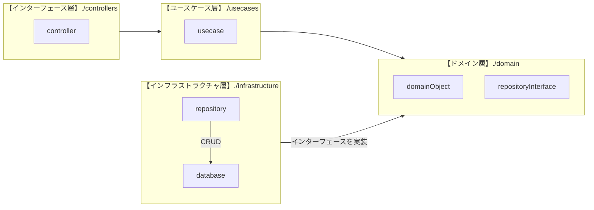

# クリーンアーキテクチャ

## はじめに

本サイトにつきまして、[【IT技術の知見】はじめに - 俺の技術ノート](https://hiroki-it.github.io/tech-notebook/) をご認識のほど宜しくお願いいたします。

<br>

## 01. アーキテクチャ概要

### 思想

ドメイン駆動設計が適する機能的アプリケーションのみでなく、あらゆる種類 (例：非機能的アプリケーションなど) のソフトウェアに適用できる。

クリーンアーキテクチャ原著の序文にて、著者は「私は今までいろいろな種類のシステムを作ってきたが、どのシステムでもアーキテクチャのルールは同じだった」と述べている。

異なるシステムでも同じルールを共有する必要がある』というようなことを述べている。

> - https://www.amazon.co.jp/dp/B07FSBHS2V

<br>

### 構成

クリーンアーキテクチャは同心円状の層で構成され、外側の層から内側の層に向かってのみ依存する。

> - [Clean Coder Blog](https://blog.cleancoder.com/uncle-bob/2012/08/13/the-clean-architecture.html)


### 各パターンの分類

オブジェクト指向型と手続き型のマルチパラダイム言語の場合、アプリケーションをクラスまたは関数で実装できる。

クリーンアーキテクチャはオブジェクト指向設計が前提にあるため、各レイヤーのパターンをクラスとして実装することが多い。

ただし、クラスとして実装するとインスタンス化の手間がある。関数として実装しても、アーキテクチャの思想に反しない場合がある (特に外側のレイヤー) 。

アーキテクチャのレイヤー別にこれを整理した。

<table>
  <thead>
    <tr>
      <th>バックエンドレイヤー</th>
      <th>パターン</th>
      <th>責務</th>
      <th>インターフェース／実装</th>
    </tr>
  </thead>
  <tbody>
    <tr>
      <td rowspan="9">インフラストラクチャ層</td>
      <td>DB</td>
      <td>データベースとの接続、コネクションの作成</td>
      <td>実装</td>
    </tr>
    <tr>
      <td>EntityMappers (DTO に相当)</td>
      <td>DB カラム型からアプリデータ型への型変換（例：<code>BIGINT</code> や <code>DECIMAL</code> を情報量が減らないデータ型に変換）、ドメインとインフラ間のオブジェクトの詰め替え</td>
      <td>実装</td>
    </tr>
    <tr>
      <td>Logger</td>
      <td>ロギング</td>
      <td>実装</td>
    </tr>
    <tr>
      <td>Middleware</td>
      <td>ミドルウェアパターン</td>
      <td>実装</td>
    </tr>
    <tr>
      <td>Repositories</td>
      <td>実装リポジトリ</td>
      <td>実装</td>
    </tr>
    <tr>
      <td>Listeners</td>
      <td>リスナー</td>
      <td>関数</td>
    </tr>
    <tr>
      <td>Routers</td>
      <td>ルーティング</td>
      <td>関数</td>
    </tr>
    <tr>
      <td>Seeder</td>
      <td>開発環境、CI 環境のユニットテストや E2E テスト、ステージング環境の動作確認に使用する初期データ挿入</td>
      <td>実装</td>
    </tr>
    <tr>
      <td>Drivers</td>
      <td>SDK、ORM、CLI など</td>
      <td>実装</td>
    </tr>
    <tr>
      <td rowspan="6">プレゼンテーション層</td>
      <td>Controller</td>
      <td>データの受信と返信</td>
      <td>実装</td>
    </tr>
    <tr>
      <td>RequestValidators</td>
      <td>受信データのバリデーション</td>
      <td>実装</td>
    </tr>
    <tr>
      <td>ResponseValidators</td>
      <td>返信データのバリデーション (受信データと比べてデータ構造は保証されているため、なくてもいい)</td>
      <td>実装</td>
    </tr>
    <tr>
      <td>Authenticators</td>
      <td>認証</td>
      <td>実装</td>
    </tr>
    <tr>
      <td>Input (Command とも呼ぶ)</td>
      <td>型変換、入力データ翻訳、フロントエンドインターフェース (あるいは受信 JSON データ) からバックエンドインターフェースへのオブジェクトへの詰め替え</td>
      <td>実装</td>
    </tr>
    <tr>
      <td>Output (DTO とも呼ぶ)</td>
      <td>型変換、出力データ翻訳、バックエンドインターフェースからフロントエンドインターフェースへのオブジェクトへの詰め替え</td>
      <td>実装</td>
    </tr>
    <tr>
      <td rowspan="6">ユースケース層</td>
      <td>Interactor</td>
      <td>ドメイン層で定義されたドメインルールを組み合わせ、ユースケースを具現化する。</td>
      <td>実装</td>
    </tr>
    <tr>
      <td>InputBoundaries</td>
      <td>Interactor のインターフェース</td>
      <td>インターフェース</td>
    </tr>
    <tr>
      <td>Input (Command とも呼ぶ)</td>
      <td>型変換、バックエンドインターフェースからユースケースのオブジェクトへの詰め替え</td>
      <td>実装</td>
    </tr>
    <tr>
      <td>OutputBoundaries</td>
      <td>Presenter のインターフェース</td>
      <td>インターフェース</td>
    </tr>
    <tr>
      <td>Output (DTO とも呼ぶ)</td>
      <td>型変換、ユースケースからフロントエンドインターフェースへのオブジェクトへの詰め替え</td>
      <td>実装</td>
    </tr>
    <tr>
      <td>Repositories（Gateways とも呼ぶ）</td>
      <td>Repositories のインターフェース</td>
      <td>インターフェース</td>
    </tr>
    <tr>
      <td rowspan="7">ドメイン層</td>
      <td>Entity</td>
      <td>ドメインモデル、ドメインルールの定義</td>
      <td>実装</td>
    </tr>
    <tr>
      <td>Id</td>
      <td>ドメインモデルの識別子</td>
      <td>実装</td>
    </tr>
    <tr>
      <td>ValueObject</td>
      <td>値オブジェクト</td>
      <td>実装</td>
    </tr>
    <tr>
      <td>Specification</td>
      <td>ビジネスロジックのバリデーション</td>
      <td>実装</td>
    </tr>
    <tr>
      <td>Criterion</td>
      <td>検索条件オブジェクト</td>
      <td>実装</td>
    </tr>
    <tr>
      <td>Events</td>
      <td>ドメインイベント</td>
      <td>実装</td>
    </tr>
    <tr>
      <td>Service</td>
      <td>ドメインサービス</td>
      <td>実装</td>
    </tr>
  </tbody>
</table>

<table>
  <thead>
    <tr>
      <th>フロントエンドレイヤー</th>
      <th>パターン</th>
      <th>責務</th>
      <th>インターフェース／実装</th>
    </tr>
  </thead>
  <tbody>
    <tr>
      <td rowspan="3">プレゼンテーション層</td>
      <td>Presenter</td>
      <td>ドメインオブジェクトから JSON データへの詰め替え</td>
      <td>実装</td>
    </tr>
    <tr>
      <td>Validators</td>
      <td>フロントエンドのバリデーション</td>
      <td>実装</td>
    </tr>
    <tr>
      <td>ViewModel</td>
      <td>状態管理、JSON データをフロントエンドインターフェースのオブジェクトへの詰め替え</td>
      <td>実装</td>
    </tr>
    <tr>
      <td>UI 層</td>
      <td>View</td>
      <td>UI レンダリング、CSS スタイリング</td>
      <td>実装</td>
    </tr>
  </tbody>
</table>

<br>

### 実装例たち

<table>
  <thead>
    <tr>
      <th>言語</th>
      <th>あれば書籍名</th>
      <th>URL</th>
    </tr>
  </thead>
  <tbody>
    <tr>
      <td>TypeScript</td>
      <td>つくりながら学ぶ！ ドメイン駆動設計 実践入門</td>
      <td><a href="https://github.com/yamachan0625/hands-on-ddd-introduction/tree/main/chapter-21">https://github.com/yamachan0625/hands-on-ddd-introduction/tree/main/chapter-21</a></td>
    </tr>
    <tr>
      <td>Java</td>
      <td>なし</td>
      <td><a href="https://github.com/VaughnVernon/IDDD_Samples">https://github.com/VaughnVernon/IDDD_Samples</a></td>
    </tr>
    <tr>
      <td>Go</td>
      <td>なし</td>
      <td><a href="https://github.com/victorsteven/food-app-server">https://github.com/victorsteven/food-app-server</a></td>
    </tr>
    <tr>
      <td>C#</td>
      <td>ドメイン駆動設計入門 ボトムアップでわかる!ドメイン駆動設計の基本</td>
      <td><a href="https://github.com/nrslib/itddd">https://github.com/nrslib/itddd</a></td>
    </tr>
    <tr>
      <td>そのほか</td>
      <td>なし</td>
      <td><a href="https://github.com/stars/hiroki-it/lists/ddd-architecture">https://github.com/stars/hiroki-it/lists/ddd-architecture</a></td>
    </tr>
  </tbody>
</table>

<br>


## 02. 依存方向の制御

### ドキュメント

レイヤー間の依存関係の方向をドキュメントで明文化する。



<br>

### 静的解析

レイヤー間の依存関係の方向を静的解析で制御する。

例えば、Go では golangci-lint の `depguard`、TypeScript では `eslint-plugin-import` プラグインの `import/no-restricted-paths` ルール、PHP では `Deptrac` が役立つ。

=== "Go"

    ```yaml title=".yml"
    version: "2"

    linters:
      enable:
        - depguard
      settings:
        depguard:
          rules:
            domain:
              # 対象のファイル
              files:
                - "**/internal/domain/**"
                - "!$test"
              # 依存禁止のパッケージ
              deny:
                # アプリケーション層に依存してはいけない
                - pkg: "example.com/foo/internal/application"
                  desc: "Domain層でApplication層をimportしてはいけません。"
                # プレゼンテーション層に依存してはいけない
                - pkg: "example.com/foo/internal/presentation"
                  desc: "Domain層でPresentation層をimportしてはいけません。"
                # インフラストラクチャ層に依存してはいけない
                - pkg: "example.com/foo/internal/infrastructure"
                  desc: "Domain層でInfrastructure層をimportしてはいけません。"
            application:
              # 対象のファイル
              files:
                - "**/internal/application/**"
                - "!$test"
              # 依存禁止のパッケージ
              deny:
                # プレゼンテーション層に依存してはいけない
                - pkg: "example.com/foo/internal/presentation"
                  desc: "Application層でPresentation層をimportしてはいけません。"
                # インフラストラクチャ層に依存してはいけない
                - pkg: "example.com/foo/internal/infrastructure"
                  desc: "Application層でInfrastructure層をimportしてはいけません。"
    ```

=== "TypeScript"

    ```typescript title="TypeScript の場合の実装例"
    import eslint from "@eslint/js";
    import tseslint from "typescript-eslint";
    import * as importPlugin from "eslint-plugin-import";

    export default tseslint.config(
      eslint.configs.recommended,
      ...tseslint.configs.recommended,

      {
        files: ["**/*.ts"],
        plugins: {
          import: importPlugin,
        },
        settings: {
          "import/resolver": {
            typescript: {},
          },
        },
        rules: {
    // (略)
          "import/no-restricted-paths": [
            "error",
            {
              zones: [
                {
                  // 依存禁止のパス
                  // アプリケーション層に依存してはいけない
                  from: "./src/Application/**/*",
                  // 対象のファイル
                  target: "./src/Domain/**/!(*.spec.ts|*.test.ts)",
                  message:
                    "Domain層でApplication層をimportしてはいけません。",
                },
                {
                  // 依存禁止のパス
                  // プレゼンテーション層に依存してはいけない
                  from: "./src/Presentation/**/*",
                  // 対象のファイル
                  target: "./src/Domain/**/!(*.spec.ts|*.test.ts)",
                  message:
                    "Domain層でPresentation層をimportしてはいけません。",
                },
                {
                  // 依存禁止のパス
                  // インフラストラクチャ層に依存してはいけない
                  from: "./src/Infrastructure/**/*!(test).ts",
                  // 対象のファイル
                  target: "./src/Domain/**/!(*.spec.ts|*.test.ts)",
                  message:
                    "Domain層でInfrastructure層をimportしてはいけません。",
                },

                {
                  // 依存禁止のパス
                  // プレゼンテーション層に依存してはいけない
                  from: "./src/Presentation/**/*",
                  // 対象のファイル
                  target: "./src/Application/**/!(*.spec.ts|*.test.ts)",
                  message:
                    "Application層でPresentation層をimportしてはいけません。",
                },
                {
                  // 依存禁止のパス
                  // インフラストラクチャ層に依存してはいけない
                  from: "./src/Infrastructure/**/*",
                  // 対象のファイル
                  target: "./src/Application/**/!(*.spec.ts|*.test.ts)",
                  message:
                    "Application層でInfrastructure層をimportしてはいけません。",
                },
              ],
            },
          ],
        },
      }
    );
    ```

=== "PHP"

    ```yaml title=".yaml"
    deptrac:
      paths:
        - ./src
      # 層とそのディレクトリ
      layers:
        - name: Domain
          collectors:
            - type: directory
              value: src/Domain/.*
        - name: Application
          collectors:
            - type: directory
              value: src/Application/.*
        - name: Presentation
          collectors:
            - type: directory
              value: src/Presentation/.*
        - name: Infrastructure
          collectors:
            - type: directory
              value: src/Infrastructure/.*
      # 依存してよい層
      ruleset:
        # ドメイン層は、ほかの層に依存してはいけない
        Domain: ~
        # アプリケーション層は、ドメイン層にのみ依存してよい
        Application:
          - Domain
        Presentation:
          - Application
          - Domain
        Infrastructure:
          - Application
          - Domain
    ```

> - [depguard - golangci-lint](https://golangci-lint.run/docs/linters/configuration/#depguard)
> - [「このパスでこのファイルのインポートをさせたくない、、、」をESLintでルール化する](https://zenn.dev/sqer/articles/35d56d9850efb2)
> - [deptrac/deptrac - GitHub](https://github.com/deptrac/deptrac)

<br>
