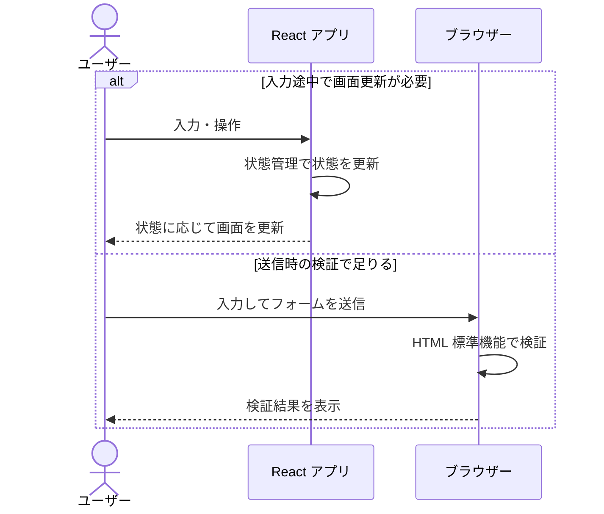

# 状態管理

## はじめに

本サイトにつきまして、[【IT技術の知見】はじめに - 俺の技術ノート](https://hiroki-it.github.io/tech-notebook/) をご認識のほど宜しくお願いいたします。

<br>

## 01. 状態管理とは

UI レンダリングに必要なデータを保持し、ユーザー操作や通信処理結果に応じて非同期に変更すること。

ユーザーの入力や操作の途中で、入力値や検証結果に応じて画面を更新する必要がある場合は、状態管理が必要です。送信時の検証だけで足りるフォームなら、HTML の標準機能で実装できます。



<br>

## 02. フレームワーク／パッケージごとの状態管理関数

フレームワーク／パッケージごとに利用できる主な状態管理関数を示す。

<table>
  <thead>
    <tr>
      <th>フレームワーク／パッケージ</th>
      <th>状態管理関数</th>
    </tr>
  </thead>
  <tbody>
    <tr>
      <td>React</td>
      <td><code>useState</code>、<code>useReducer</code>、<code>useRef</code>、<code>useContext</code></td>
    </tr>
    <tr>
      <td>Vue.js</td>
      <td><code>ref</code>、<code>reactive</code>、<code>computed</code>、<code>watch</code></td>
    </tr>
    <tr>
      <td>Next.js (React と同じ)</td>
      <td><code>useState</code>、<code>useReducer</code>、<code>useRef</code>、<code>useSyncExternalStore</code>、<code>useContext</code></td>
    </tr>
    <tr>
      <td>Nuxt.js (Vue.js と同じ)</td>
      <td><code>ref</code>、<code>reactive</code>、<code>computed</code>、<code>watch</code></td>
    </tr>
  </tbody>
</table>

<br>

## 03. 状態管理するべきデータ

### 選択途中の絞り込み条件

UI で次を設定している間、そのデータをバックエンドに送信することなく、フロントエンド上で管理する。

また、管理されたデータに応じた UI を表示する。

- 絞り込み項目の設定
- 並び替え項目と昇順／降順の設定
- OR 条件と AND 条件の設定

最終的に決定ボタンが押されたタイミングで状態をバックエンドに送信する。

<br>

### カーソルをあてている表示項目

UI で次のように操作している間、カーソルを当てている表示項目のデータをフロントエンド上でのみ管理する。

また、管理されたデータに応じた UI を表示する。

- グラフや表の値にカーソルをあてる
- カレンダーの日付にカーソルをあてる
- 地図の位置にカーソルをあてる

<br>

## 04. MVP アーキテクチャ

### MVP アーキテクチャとは

以下の要素が該当のロジックをもつ。

- View：UI レンダリングロジック、CSS スタイリングロジック
- Presenter：状態管理ロジック
- Model：機能モデル

<br>

## 05. MVVM アーキテクチャ

### MVVM アーキテクチャとは

以下の要素が該当のロジックをもつ。

- View：UI レンダリングロジック、CSS スタイリングロジック
- ViewModel：状態管理ロジック
- Model：機能モデル

View と Model の間に ViewModel を配置し、View と ViewModel の間で双方向にデータをやり取り (双方向データバインディング) する。

これによって、View と Model の間を疎結合にする。

Vue.js では、意識せずに MVVM アーキテクチャで実装できるようになっている。


<br>

### 状態管理との関係性

以下の状態管理を使用している場合、MVVM アーキテクチャで構築することになる。

- CSR

> - [SSRアプリではMVCが主流で、SPAではMVVMが主流、だとしてそれは何故だろうか？: ほしまど のweblog](http://fluorite2.sblo.jp/article/189587309.html)

<br>

## 06. Flux アーキテクチャ

Action、Dispatcher、Store、View の間でデータを一方向に流し、状態を管理する。

<br>

## 07. Redux アーキテクチャ

Flux アーキテクチャをもとに、アプリケーション全体の状態を単一の Store で管理し、Action を受け取った Reducer が新しい状態を返すことで状態を更新する。

<br>

## 08. アンチパターン

### 状態を直接書き換えない

例えば、ToDo リストの追加ボタンを押したときに、状態の配列に `push` で要素を足してから `setItems(items)` を呼ぶとする。

React は、前と同じ配列かどうかだけを見て状態が変わったかを判断するため、中身が増えても同じ配列のままなら画面を描き直さない。

すると、ユーザーがTODOリストに『牛乳を買う』と入力して追加ボタンを押しても、その後に画面の ToDo リストに出てこない。

そのため、状態を更新するときは、新しい配列やオブジェクトを作って渡す。

```tsx
const [items, setItems] = useState<string[]>([]);

const addItem = (item: string) => {
  // NG：同じ配列を書き換えているため、再描画されない
  // items.push(item);
  // setItems(items);

  // OK：新しい配列を作って渡す
  setItems([...items, item]);
};
```

<br>

### 入力欄の制御方法を混ぜない

例えば、検索欄の状態の初期値を `undefined` にして `value` に渡し、クリアボタンで状態を `undefined` に戻すとする。

すると、ユーザーが検索欄に『東京』と入力したあと、消そうとしてクリアボタンを押しても、検索欄には『東京』が残ったままになる。

一方で、状態は空に戻っているため、検索結果だけが絞り込みなしの状態に戻ってしまう。

そのため、`value` で管理する場合は初期値を空文字にし、ブラウザに任せる場合は `defaultValue` を使う。

```tsx
// NG：初期値が undefined のため、非制御から制御に変わる
// const [keyword, setKeyword] = useState<string>();
// const clear = () => setKeyword(undefined);

// OK：初期値を空文字にし、クリアするときも空文字に戻す
const [keyword, setKeyword] = useState<string>("");
const clear = () => setKeyword("");

return (
  <>
    <input value={keyword} onChange={(e) => setKeyword(e.target.value)} />
    <button onClick={clear}>クリア</button>
  </>
);
```

<br>

### 不要な状態を作らない

- 特定の値を二重管理していないか
- コンポーネントにそのまま出力すればいい値を状態としてわざわざ管理していないか

```tsx
const [firstName, setFirstName] = useState("太郎");
const [lastName, setLastName] = useState("山田");

// NG：firstName または lastName を更新するたびに、fullName も更新する必要がある
// const [fullName, setFullName] = useState("山田 太郎");

// OK：必要なときに既存の状態から算出する
const fullName = `${lastName} ${firstName}`;
```

<br>

### 状態を初期値に戻す

#### ▼ モーダルに関する状態の初期化

例えば、結果待ちの間に確認モーダルを閉じても、確認モーダルの状態はページのコンポーネントが持つため、見えないところで『結果を待っている』状態が残ってしまう。

すると、ユーザーが次に確認モーダルを開くと、まだ何も実行していないのに結果待ちの表示が出ていて実行ボタンを押しても何も起きず、ページを再読み込みするまで実行できなくなってしまう。

そのため、閉じるときはモーダル用の状態も初期値に戻し、閉じる操作が複数ある場合は 1 つの関数にまとめる。

```tsx
// NG：モーダルを閉じるだけで、処理中やエラーの状態を残す
// const closeModal = () => setIsModalOpen(false);

const closeModal = () => {
  setIsWaitingForResult(false);
  setModalError(undefined);
  setIsModalOpen(false);
};

return (
  <ConfirmationModal
    isOpen={isModalOpen}
    // 閉じるボタン
    onClickClose={closeModal}
    // キャンセルボタン
    onClickNoButton={closeModal}
  />
);
```

<br>

#### ▼ フォームに関する状態の初期化

例えば、`useFetcher` でフォームを送信すると、ページを移動しないため、入力欄は送信前のまま表示され続ける。

すると、入力欄に送信した値が見えたままになり、送信できたのかがわかりにくく、そのまま登録ボタンを押すと同じ内容を二重に登録してしまう。

そのため、送信が成功したら、入力欄を初期値に戻す。

```tsx
import {useFetcher} from "@remix-run/react";
import React, {useEffect, useRef} from "react";

export default () => {
  const fetcher = useFetcher<typeof action>();
  const formRef = useRef<HTMLFormElement>(null);

  // NG：送信成功後もフォームを初期化しない
  // useEffect(() => {
  //   if (fetcher.state === "idle" && fetcher.data?.ok) {
  //     // formRef.current?.reset(); を呼び出さない
  //   }
  // }, [fetcher.state, fetcher.data]);

  useEffect(() => {
    // 送信が完了し、成功した場合に入力欄を初期値に戻す
    if (fetcher.state === "idle" && fetcher.data?.ok) {
      formRef.current?.reset();
    }
  }, [fetcher.state, fetcher.data]);

  return (
    <fetcher.Form method="post" ref={formRef}>
      <input name="name" />
      <button type="submit">登録</button>
    </fetcher.Form>
  );
};
```

<br>

#### ▼ 編集に関する状態の初期化

例えば、編集をキャンセルしても、入力欄には編集途中の値が残ったままになる。

すると、ユーザーが次に編集ボタンを押すと、キャンセルしたはずの値が入力欄に表示されていて、保存されたのかキャンセルされたのか判断できなくなってしまう。

そのため、キャンセルしたら、入力欄を保存されている値に戻す。

```tsx
const [name, setName] = useState<string>(project.name);
const [isEditing, setIsEditing] = useState<boolean>(false);

// NG：編集途中の値を戻さずに、編集状態だけを終了する
// const cancelEdit = () => setIsEditing(false);

const cancelEdit = () => {
  // 保存されている値に戻す
  setName(project.name);
  setIsEditing(false);
};
```

<br>

#### ▼ エラーに関する状態の初期化

例えば、処理に失敗するとエラーメッセージを状態に保存するが、再実行してもこの状態は自動では消えない。

すると、ユーザーが再実行して成功しても、画面には前回の失敗のエラーメッセージが表示されたままになり、また失敗したと思って何度も実行してしまう。

そのため、再実行する前に、エラーを初期値に戻す。

```tsx
const [error, setError] = useState<string | undefined>();

const run = async () => {
  // NG：前回のエラーを残したまま再実行する
  // try {
  //   await execute();
  // } catch (e) {
  //   setError("実行に失敗しました");
  // }

  // 前回のエラーを消してから実行する
  setError(undefined);
  try {
    await execute();
  } catch (e) {
    setError("実行に失敗しました");
  }
};
```

<br>
