# マイクロサービスアーキテクチャ＠アーキテクチャ

## はじめに

本サイトにつきまして、以下をご認識のほど宜しくお願いいたします。

> - [【IT技術の知見】はじめに - 俺の技術ノート](https://hiroki-it.github.io/tech-notebook/)

 

## 01. アーキテクチャ概要

### アーキテクチャの歴史

<table>
  <thead>
    <tr>
      <th>年代</th>
      <th>アーキテクチャ</th>
      <th>説明</th>
      <th>補足</th>
    </tr>
  </thead>
  <tbody>
    <tr>
      <td>1999</td>
      <td>モノリシックアーキテクチャ</td>
      <td>1999 年台、バックエンドのアーキテクチャとしてモノリシックアーキテクチャが台頭していた。しかし、モノリシックアーキテクチャは無秩序でつぎはぎだらけのアプリケーションになることが論文 (『大きな泥だんご』) で指摘された。</td>
      <td>・<a href="https://en.wikipedia.org/wiki/Big_ball_of_mud">https://en.wikipedia.org/wiki/Big_ball_of_mud</a></td>
    </tr>
    <tr>
      <td>2000 〜 2004</td>
      <td>サービス指向アーキテクチャ</td>
      <td>1999 後半〜2000 前半に、Thomas Erl らがアプリケーションを機能の粒度で分割するアーキテクチャを提唱した。ただ『機能』という粒度が抽象的で、概念としては提唱されていても、実装方法の確立にまでは至らなかった。</td>
      <td>・<a href="https://en.wikipedia.org/wiki/Service-oriented_architecture">https://en.wikipedia.org/wiki/Service-oriented_architecture</a>  ・<a href="https://www.serviceorientation.org/p0.html">https://www.serviceorientation.org/p0.html</a>  ・<a href="https://www.amazon.com/dp/0470141115">https://www.amazon.com/dp/0470141115</a></td>
    </tr>
    <tr>
      <td>2014</td>
      <td>マイクロサービスアーキテクチャ</td>
      <td>2014 年に ThoughtWorks 社は、サービス指向アーキテクチャとドメイン駆動設計を統合し、アプリケーションを独立したマイクロサービスの集まりに分割するアーキテクチャを提唱した。サービス指向アーキテクチャにドメイン駆動設計の高凝集/低結合の考え方を取り入れることで、実装可能な理論に昇華させた。</td>
      <td>・<a href="https://martinfowler.com/articles/microservices.html">https://martinfowler.com/articles/microservices.html</a>  ・<a href="https://atmarkit.itmedia.co.jp/ait/articles/2110/22/news006.html">https://atmarkit.itmedia.co.jp/ait/articles/2110/22/news006.html</a></td>
    </tr>
    <tr>
      <td>2017</td>
      <td>ミニマイクロサービスアーキテクチャ</td>
      <td>マイクロサービスアーキテクチャのマイクロサービス自体を独立したモノリスなアプリケーションと捉えると、その分だけ開発チーム (マネージャーとエンジニア) が必要になってしまう。2017 年に Cloud Elements 社は、これに対処するためにミニマイクロサービスアーキテクチャを提唱した。このアーキテクチャでは、マイクロサービスアーキテクチャとモノリスアーキテクチャの間をとった粒度で、アプリケーションを複数のマイクロサービスに分割する。この粒度を、マイクロサービスに対抗して『ミニマイクロサービス』または『MASA』とよぶ。</td>
      <td>・<a href="https://blog.cloud-elements.com/pragmatic-microservices-architecture">https://blog.cloud-elements.com/pragmatic-microservices-architecture</a>  ・<a href="https://atmarkit.itmedia.co.jp/ait/articles/2110/22/news006.html">https://atmarkit.itmedia.co.jp/ait/articles/2110/22/news006.html</a></td>
    </tr>
    <tr>
      <td>2018</td>
      <td>モジュラーモノリスアーキテクチャ</td>
      <td>ミニマイクロサービスアーキテクチャではマイクロサービスの粒度が大きくなったものの、複数のマイクロサービスが必要になることは変わらず、その分だけ開発チームが必要になる問題は解決されなかった。そこで、Root Insurance 社はモジュラーモノリスを提唱した。モジュラモノリスでは、マイクロサービスアーキテクチャとモノリスアーキテクチャの間をとった粒度で、アプリケーションを細かいモジュールに分割する。最初、モジュラーモノリスとして設計し、マイクロサービスアーキテクチャに移行していくという選択肢もある。</td>
      <td>・<a href="https://medium.com/@dan_manges/the-modular-monolith-rails-architecture-fb1023826fc4">https://medium.com/@dan_manges/the-modular-monolith-rails-architecture-fb1023826fc4</a>  ・<a href="https://creators-note.chatwork.com/entry/2020/12/02/090000">https://creators-note.chatwork.com/entry/2020/12/02/090000</a>  ・<a href="https://eh-career.com/engineerhub/entry/2022/07/25/093000">https://eh-career.com/engineerhub/entry/2022/07/25/093000</a></td>
    </tr>
  </tbody>
</table>

> - https://medium.com/@techworldwithmilan/most-common-software-architecture-styles-86881d779683
> - [アーキテクチャ 【まとめ】 -マイクロサービス、ミニサービス、モジュラーモノリス、モノリシックアーキテクチャを並べて比べてみました- - RAKUS Developers Blog \| ラクス エンジニアブログ](https://tech-blog.rakus.co.jp/entry/20201218/architecture)

 

### 各アーキテクチャの粒度の比較

<table>
  <thead>
    <tr>
      <th>モジュールの大きさ</th>
      <th>粒度名</th>
      <th>説明</th>
    </tr>
  </thead>
  <tbody>
    <tr>
      <td>一番大きい</td>
      <td>モノリシック</td>
      <td>アプリケーションのモジュールが分割されておらず、アプリケーションをデプロイの単位とする。</td>
    </tr>
    <tr>
      <td></td>
      <td>モジュラー</td>
      <td>アプリケーションがモジュールに分割されており、アプリケーションをデプロイの単位とする。モジュール間のデータのやり取りに通信を使用するか否かや、モジュール間で DB を共有するか否かの選択によって、作成パターンがいくつかある。 ・<a href="https://scrapbox.io/tsuwatch/%E3%83%A2%E3%83%8E%E3%83%AA%E3%82%B9%E3%81%A8%E3%83%9E%E3%82%A4%E3%82%AF%E3%83%AD%E3%82%B5%E3%83%BC%E3%83%93%E3%82%B9%E3%81%AE%E3%81%82%E3%81%84%E3%81%A0">https://scrapbox.io/tsuwatch/モノリスとマイクロサービスのあいだ</a></td>
    </tr>
    <tr>
      <td></td>
      <td>ミニマイクロサービス</td>
      <td>アプリケーションがサブドメイン (または境界づけられたコンテキスト) を単位としたマイクロサービスに分割されており、アプリケーションを構成するマイクロサービスのある程度のまとまりをデプロイの単位とする。また、DB を各マイクロサービスで共有する。</td>
    </tr>
    <tr>
      <td>一番小さい</td>
      <td>マイクロ</td>
      <td>アプリケーションがサブドメイン (または境界づけられたコンテキスト) を単位としたマイクロサービスに分割されており、1 つの集約を分割の単位とすることもある。アプリケーションを構成するマイクロサービスそれぞれをデプロイの単位とする。また、DB を各マイクロサービスで共有せずに、マイクロサービスごとに配置する。</td>
    </tr>
  </tbody>
</table>

> - [アーキテクチャ 【まとめ】 -マイクロサービス、ミニサービス、モジュラーモノリス、モノリシックアーキテクチャを並べて比べてみました- - RAKUS Developers Blog \| ラクス エンジニアブログ](https://tech-blog.rakus.co.jp/entry/20201218/architecture)

 

### プレゼンテーション・ドメイン分離

モノリシックの段階では、フロントエンド領域とバックエンド領域が 1 つのアプリケーションで密結合になっている。

フロントエンド領域とバックエンド領域を分離した段階では、フロントエンド領域とバックエンド領域が異なるアプリケーションとして分離される。

マイクロサービスでの段階では、さらにバックエンドが複数のアプリケーションに分離され、必要に応じて API アグリゲーション層を配置する。

> - https://cloud.google.com/architecture/devops/devops-tech-architecture
> - https://docs.microsoft.com/ja-jp/azure/architecture/microservices/migrate-monolith
> - https://bliki-ja.github.io/PresentationDomainSeparation/
> - [MicroFrontends について調査しました - エムティーアイ エンジニアリングブログ](https://tech.mti.co.jp/entry/2021/04/12/112833)

 

### 関連パターン

#### ▼ 関連パターンとは

マイクロサービスアーキテクチャでは固有の問題が起こる。

これを解決するための関連パターンがたくさんある。

> - [A pattern language for microservices](https://microservices.io/patterns/)

**＊実装例＊**

`microservices.io` サイトで紹介しきれていない実装方法は、`softwarepatternslexicon` サイトで確認できる。

> - [Microservices Architecture & Design Patterns \| Software Patterns Lexicon](https://softwarepatternslexicon.com/microservices/)

#### ▼ マイクロサービスアーキテクチャとクラウドネイティブ

優れたクラウドネイティブアプリケーションを作成するには、マイクロサービスアーキテクチャとクラウドネイティブ技術が必要である。

マイクロサービスアーキテクチャの関連パターンは、クラウドネイティブ技術で代替できる。

<table>
  <thead>
    <tr>
      <th>マイクロサービスの関連パターン</th>
      <th>クラウドネイティブ技術</th>
    </tr>
  </thead>
  <tbody>
    <tr>
      <td>Externalized configuration</td>
      <td>Kubernetes ConfigMap、Kubernetes Secret</td>
    </tr>
    <tr>
      <td>サービス検出</td>
      <td>権威 DNS ツール (CoreDNS など)</td>
    </tr>
    <tr>
      <td>負荷分散</td>
      <td>Kubernetes Service</td>
    </tr>
    <tr>
      <td>API ゲートウェイ</td>
      <td>Kubernetes Ingress</td>
    </tr>
    <tr>
      <td>集中ロギング</td>
      <td>Fluentd</td>
    </tr>
    <tr>
      <td>集中メトリクス</td>
      <td>Prometheus、Grafana</td>
    </tr>
    <tr>
      <td>分散トレース</td>
      <td>OpenTelemetry、Grafana Tempo</td>
    </tr>
    <tr>
      <td>回復力</td>
      <td>Kubernetes Probe、Istio</td>
    </tr>
    <tr>
      <td>自己回復</td>
      <td>Kubernetes Deployment</td>
    </tr>
    <tr>
      <td>...</td>
      <td>...</td>
    </tr>
  </tbody>
</table>

> - [Microservices - Wikipedia](https://en.wikipedia.org/wiki/Microservices#A_comparison_of_platforms)
> - https://developers.redhat.com/articles/2023/04/05/kubernetes-patterns-path-cloud-native

 

## 02. マイクロサービスアーキテクチャの特徴

### 特徴

#### ▼ ビジネスのスケーリングに強い

ビジネスがスケーリングするとき、マイクロサービスを新規実装したり削除したりすればよいため、ドメイン層の激しい変化に強い。

#### ▼ コンウェイの法則が働く

マイクロサービスアーキテクチャにより、組織構造が小さなチームの集まりに変化することを期待できる。

#### ▼ 高頻度でリリース可能

各マイクロサービスを独立してデプロイできるため、高頻度でリリースできる。

#### ▼ 障害の影響が部分的

いずれかのマイクロサービスに障害が発生したとして、サーキットブレイカーを使用することで、送信元マイクロサービスへの障害の波及を食い止められる。

そのため、障害の影響範囲を小さくできる。ただし、サーキットブレイカーの発動時には送信元でエラーが発生するため、依存する機能を継続するにはフォールバックなどの代替処理が必要になる。

#### ▼ 複数の開発言語を使用可能

マイクロサービス間で、共通のデータ記述言語を使用して通信すれば、各マイクロサービスの開発言語が異なっていても問題ない。

 

### アーキテクチャ例

#### ▼ E コマース (Google のサンプル)

`src` ディレクトリに各マイクロサービスのディレクトリを配置する。

<table>
  <thead>
    <tr>
      <th>サービス名</th>
      <th>コンポーネントの種類</th>
      <th>分割の観点</th>
    </tr>
  </thead>
  <tbody>
    <tr>
      <td>adservice</td>
      <td>業務マイクロサービス</td>
      <td>境界づけられたコンテキスト (広告配信)</td>
    </tr>
    <tr>
      <td>cartservice</td>
      <td>業務マイクロサービス</td>
      <td>境界づけられたコンテキスト (カート)</td>
    </tr>
    <tr>
      <td>checkoutservice</td>
      <td>オーケストレーターサービス</td>
      <td>ほかのマイクロサービスの調整 (購入処理の統合)</td>
    </tr>
    <tr>
      <td>currencyservice</td>
      <td>業務マイクロサービス</td>
      <td>境界づけられたコンテキスト (通貨換算)</td>
    </tr>
    <tr>
      <td>emailservice</td>
      <td>業務マイクロサービス</td>
      <td>非同期的な機能 (通知／メール送信)</td>
    </tr>
    <tr>
      <td>frontend</td>
      <td>フロントエンドアプリケーション</td>
      <td>プレゼンテーション</td>
    </tr>
    <tr>
      <td>paymentservice</td>
      <td>業務マイクロサービス</td>
      <td>境界づけられたコンテキスト (決済)</td>
    </tr>
    <tr>
      <td>productcatalogservice</td>
      <td>業務マイクロサービス</td>
      <td>境界づけられたコンテキスト (商品カタログ)</td>
    </tr>
    <tr>
      <td>recommendationservice</td>
      <td>業務マイクロサービス</td>
      <td>境界づけられたコンテキスト (レコメンド)</td>
    </tr>
    <tr>
      <td>shippingservice</td>
      <td>業務マイクロサービス</td>
      <td>境界づけられたコンテキスト (配送)</td>
    </tr>
  </tbody>
</table>

> - [GitHub - GoogleCloudPlatform/microservices-demo: Sample cloud-first application with 10 microservices showcasing Kubernetes, Istio, and gRPC. · GitHub](https://github.com/GoogleCloudPlatform/microservices-demo)

#### ▼ E コマース (メルカリのサンプル)

`services` ディレクトリに各マイクロサービスのディレクトリを配置する。

<table>
  <thead>
    <tr>
      <th>サービス名</th>
      <th>コンポーネントの種類</th>
      <th>分割の観点</th>
    </tr>
  </thead>
  <tbody>
    <tr>
      <td>authority</td>
      <td>認証マイクロサービス</td>
      <td>認証処理</td>
    </tr>
    <tr>
      <td>catalog</td>
      <td>業務マイクロサービス</td>
      <td>境界づけられたコンテキスト (カタログ)</td>
    </tr>
    <tr>
      <td>customer</td>
      <td>業務マイクロサービス</td>
      <td>境界づけられたドメイン (顧客管理)</td>
    </tr>
    <tr>
      <td>gateway</td>
      <td>API ゲートウェイ</td>
      <td>API ゲートウェイ</td>
    </tr>
    <tr>
      <td>item</td>
      <td>業務マイクロサービス</td>
      <td>境界づけられたドメイン (商品管理)</td>
    </tr>
  </tbody>
</table>

> - [GitHub - mercari/mercari-microservices-example · GitHub](https://github.com/mercari/mercari-microservices-example)

#### ▼ E コマース (Datadog のサンプル)

<table>
  <thead>
    <tr>
      <th>サービス名</th>
      <th>コンポーネントの種類</th>
      <th>分割の観点</th>
    </tr>
  </thead>
  <tbody>
    <tr>
      <td>advertisements-service</td>
      <td>業務マイクロサービス</td>
      <td>境界づけられたコンテキスト (広告)</td>
    </tr>
    <tr>
      <td>cart-service</td>
      <td>業務マイクロサービス</td>
      <td>境界づけられたコンテキスト (カート)</td>
    </tr>
    <tr>
      <td>catalog-service</td>
      <td>業務マイクロサービス</td>
      <td>境界づけられたコンテキスト (商品カタログ)</td>
    </tr>
    <tr>
      <td>checkout-service</td>
      <td>業務マイクロサービス</td>
      <td>境界づけられたコンテキスト (チェックアウト)</td>
    </tr>
    <tr>
      <td>discounts-service</td>
      <td>業務マイクロサービス</td>
      <td>境界づけられたコンテキスト (割引)</td>
    </tr>
    <tr>
      <td>orders-service</td>
      <td>業務マイクロサービス</td>
      <td>境界づけられたコンテキスト (注文管理)</td>
    </tr>
    <tr>
      <td>payment-service</td>
      <td>業務マイクロサービス</td>
      <td>境界づけられたコンテキスト (決済)</td>
    </tr>
    <tr>
      <td>shipping-service</td>
      <td>業務マイクロサービス</td>
      <td>境界づけられたコンテキスト (配送)</td>
    </tr>
    <tr>
      <td>store-frontend</td>
      <td>フロントエンドアプリケーション</td>
      <td>UI</td>
    </tr>
    <tr>
      <td>users-service</td>
      <td>業務マイクロサービス</td>
      <td>境界づけられたコンテキスト (ユーザー管理)</td>
    </tr>
  </tbody>
</table>

次の図は、表にある境界づけられたコンテキストと業務マイクロサービスの対応を示す。各枠の中でその業務のモデルを定義する。

```mermaid
flowchart TB
  subgraph advertisements["広告コンテキスト"]
    advertisementsService["advertisements-service"]
  end
  subgraph cart["カートコンテキスト"]
    cartService["cart-service"]
  end
  subgraph catalog["商品カタログコンテキスト"]
    catalogService["catalog-service"]
  end
  subgraph checkout["チェックアウトコンテキスト"]
    checkoutService["checkout-service"]
  end
  subgraph discounts["割引コンテキスト"]
    discountsService["discounts-service"]
  end
  subgraph orders["注文管理コンテキスト"]
    ordersService["orders-service"]
  end
  subgraph payment["決済コンテキスト"]
    paymentService["payment-service"]
  end
  subgraph shipping["配送コンテキスト"]
    shippingService["shipping-service"]
  end
  subgraph users["ユーザー管理コンテキスト"]
    usersService["users-service"]
  end
```

> - [GitHub - DataDog/ecommerce-workshop: ## Auto-archived due to inactivity. ## Example eCommerce App for workshops and observability · GitHub](https://github.com/DataDog/ecommerce-workshop)

#### ▼ E コマース (Amazon)

<table>
  <thead>
    <tr>
      <th>サービス名</th>
      <th>コンポーネントの種類</th>
      <th>分割の観点</th>
    </tr>
  </thead>
  <tbody>
    <tr>
      <td>cart service</td>
      <td>業務マイクロサービス</td>
      <td>境界づけられたコンテキスト (カート)</td>
    </tr>
    <tr>
      <td>inbound service</td>
      <td>業務マイクロサービス</td>
      <td>境界づけられたコンテキスト (仕入管理)</td>
    </tr>
    <tr>
      <td>inventory service</td>
      <td>業務マイクロサービス</td>
      <td>境界づけられたコンテキスト (在庫)</td>
    </tr>
    <tr>
      <td>item service</td>
      <td>業務マイクロサービス</td>
      <td>境界づけられたコンテキスト (商品管理)</td>
    </tr>
    <tr>
      <td>logistic service</td>
      <td>業務マイクロサービス</td>
      <td>境界づけられたコンテキスト (物流)</td>
    </tr>
    <tr>
      <td>notification service</td>
      <td>業務マイクロサービス</td>
      <td>非同期的な機能 (通知)</td>
    </tr>
    <tr>
      <td>order taking service</td>
      <td>業務マイクロサービス</td>
      <td>境界づけられたコンテキスト (注文)</td>
    </tr>
    <tr>
      <td>payment service</td>
      <td>業務マイクロサービス</td>
      <td>境界づけられたコンテキスト (決済)</td>
    </tr>
    <tr>
      <td>recommendation service</td>
      <td>業務マイクロサービス</td>
      <td>境界づけられたコンテキスト (レコメンド)</td>
    </tr>
    <tr>
      <td>search service</td>
      <td>業務マイクロサービス</td>
      <td>境界づけられたコンテキスト (検索)</td>
    </tr>
    <tr>
      <td>serviceability &amp; TAT service</td>
      <td>業務マイクロサービス</td>
      <td>境界づけられたコンテキスト (配送可否判定)</td>
    </tr>
    <tr>
      <td>user service</td>
      <td>業務マイクロサービス</td>
      <td>境界づけられたコンテキスト (ユーザー)</td>
    </tr>
    <tr>
      <td>warehouse service</td>
      <td>業務マイクロサービス</td>
      <td>境界づけられたコンテキスト (倉庫)</td>
    </tr>
    <tr>
      <td>wishlist service</td>
      <td>業務マイクロサービス</td>
      <td>境界づけられたコンテキスト (ウィッシュリスト)</td>
    </tr>
    <tr>
      <td>...</td>
      <td>...</td>
      <td>...</td>
    </tr>
  </tbody>
</table>

> - [CodeKarle: Amazon System Design \| E Commerce System Design](https://www.codekarle.com/system-design/Amazon-system-design.html)

#### ▼ SNS (Twitter)

<table>
  <thead>
    <tr>
      <th>サービス名</th>
      <th>コンポーネントの種類</th>
      <th>分割の観点</th>
    </tr>
  </thead>
  <tbody>
    <tr>
      <td>asset service</td>
      <td>業務マイクロサービス</td>
      <td>境界づけられたコンテキスト (メディア資産管理)</td>
    </tr>
    <tr>
      <td>graph service</td>
      <td>業務マイクロサービス</td>
      <td>境界づけられたコンテキスト (フォロー関係／グラフ)</td>
    </tr>
    <tr>
      <td>search service</td>
      <td>業務マイクロサービス</td>
      <td>境界づけられたコンテキスト (検索)</td>
    </tr>
    <tr>
      <td>tweet ingestion service</td>
      <td>業務マイクロサービス</td>
      <td>境界づけられたコンテキスト (ツイート書き込み)</td>
    </tr>
    <tr>
      <td>tweet service</td>
      <td>業務マイクロサービス</td>
      <td>境界づけられたコンテキスト (ツイート読み込み)</td>
    </tr>
    <tr>
      <td>timeline service</td>
      <td>業務マイクロサービス</td>
      <td>境界づけられたコンテキスト (タイムライン生成)</td>
    </tr>
    <tr>
      <td>user live websocket service</td>
      <td>業務マイクロサービス</td>
      <td>境界づけられたコンテキスト (リアルタイム接続)</td>
    </tr>
    <tr>
      <td>user service</td>
      <td>業務マイクロサービス</td>
      <td>境界づけられたコンテキスト (ユーザー管理)</td>
    </tr>
    <tr>
      <td>...</td>
      <td>...</td>
      <td>...</td>
    </tr>
  </tbody>
</table>

> - [CodeKarle: Twitter System Design](https://www.codekarle.com/system-design/Twitter-system-design.html)

#### ▼ 地図 (Google Map)

<table>
  <thead>
    <tr>
      <th>サービス名</th>
      <th>コンポーネントの種類</th>
      <th>分割の観点</th>
    </tr>
  </thead>
  <tbody>
    <tr>
      <td>asset service</td>
      <td>業務マイクロサービス</td>
      <td>境界づけられたコンテキスト (メディア資産管理)</td>
    </tr>
    <tr>
      <td>graph processing service</td>
      <td>業務マイクロサービス</td>
      <td>境界づけられたコンテキスト (グラフ処理／ルート計算)</td>
    </tr>
    <tr>
      <td>location service</td>
      <td>業務マイクロサービス</td>
      <td>境界づけられたコンテキスト (ユーザー位置情報管理)</td>
    </tr>
    <tr>
      <td>map service</td>
      <td>業務マイクロサービス</td>
      <td>境界づけられたコンテキスト (地図レンダリング／タイル提供)</td>
    </tr>
    <tr>
      <td>navigation service</td>
      <td>業務マイクロサービス</td>
      <td>境界づけられたコンテキスト (ナビゲーション指示)</td>
    </tr>
    <tr>
      <td>real-time traffic update service</td>
      <td>業務マイクロサービス</td>
      <td>境界づけられたコンテキスト (交通情報更新)</td>
    </tr>
    <tr>
      <td>search/area-search service</td>
      <td>業務マイクロサービス</td>
      <td>境界づけられたコンテキスト (検索／住所変換)</td>
    </tr>
    <tr>
      <td>websocket handler service</td>
      <td>業務マイクロサービス</td>
      <td>境界づけられたコンテキスト (リアルタイム接続管理)</td>
    </tr>
    <tr>
      <td>historical data service</td>
      <td>業務マイクロサービス</td>
      <td>境界づけられたコンテキスト (過去データ／ETA 分析)</td>
    </tr>
    <tr>
      <td>...</td>
      <td>...</td>
      <td>...</td>
    </tr>
  </tbody>
</table>

> - [CodeKarle: Google Maps System Design \| Apple Maps System Design](https://www.codekarle.com/system-design/Google_Maps-system-design.html)

 

### マイクロサービスアーキテクチャフレームワーク

#### ▼ マイクロサービスアーキテクチャフレームワークとは

マイクロサービスアーキテクチャのフレームワークとして、Dapr、Spring Cloud、Axon、Eventuate、MicroProfile LRA などがある。

> - [Dapr × Kubernetes ではじめるポータブルなマイクロサービス / portable microservices with Dapr and Kubernetes - Speaker Deck](https://speakerdeck.com/polar3130/portable-microservices-with-dapr-and-kubernetes?slide=24)
> - [マイクロソフト、マイクロサービス開発を容易にする「Dapr」をオープンソースで公開。サービス間呼び出し、ステート管理、サービス間メッセージングなど提供 － Publickey](https://www.publickey1.jp/blog/19/dapr.html)
> - [GitHub - dapr/dapr: Dapr is a portable runtime for building distributed applications across cloud and edge, combining event-driven architecture with workflow orchestration. · GitHub](https://github.com/dapr/dapr)

#### ▼ サービスメッシュとの違い

マイクロサービスアーキテクチャフレームワークは、非機能ロジックのなかでもより機能ロジックに近い SDK やドライバーのようなロジック（ストレージ接続ロジック、メッセージブローカー接続ロジック）を提供する。

一方で、サービスメッシュは SDK やドライバーには対応していない。

 
