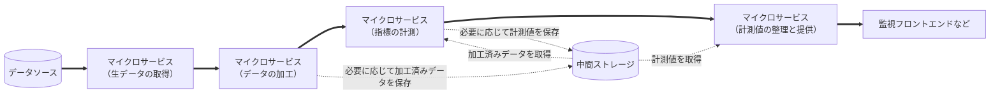
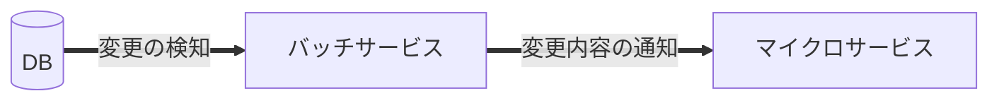

# データ処理ワークフロー

## はじめに

本サイトにつきまして、[【IT技術の知見】はじめに - 俺の技術ノート](https://hiroki-it.github.io/tech-notebook/) をご認識のほど宜しくお願いいたします。

 

## 01. ETL パターン

次の処理フェーズをマイクロサービスで構成する。

1. データソースから生データを取得するマイクロサービス（業務マイクロサービス、バッチサービスなど）
2. 生データを処理しやすいように事前に加工するマイクロサービス
   - 必要であればストレージに一度永続化し、データ共有方式で後続のマイクロサービスに渡す
3. 加工されたデータから、何らかの指標（例：メトリクスなど）を計測する
   - 必要であればストレージに一度永続化し、データ共有方式で後続のマイクロサービスに渡す
4. 計測値の構造を整理し、監視フロントエンドやクライアントに提供する

ちょっとしたデータ処理ワークフローであれば、マイクロサービスとして切り分けずに、モノリスアプリケーションのユースケース層でこれらのフローを実施する

> - [『Kubernetes ☸️ で実践する Platform Engineering 』を最高速度で読み抜いたる！！👊🏻 - Speaker Deck](https://speakerdeck.com/hiroki_hasegawa/kubernetesdeshi-jian-suru-platform-engineering-zui-gao-su-du-dedu-miba-itaru?slide=12)

 

## 02. CDC パターン

データソースの DB で発生した変更を検知し、変更内容をイベントとして後続のマイクロサービスに渡す。

 
