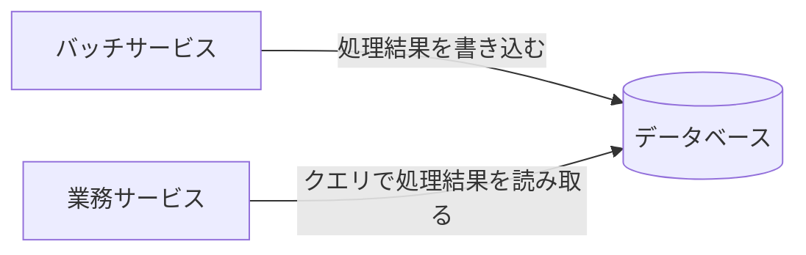
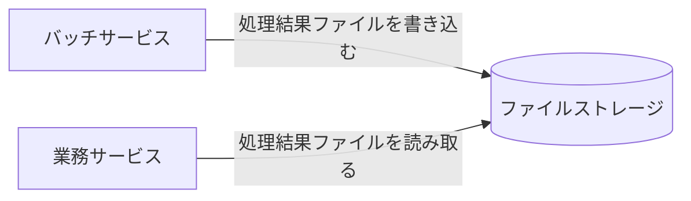

# データ共有方式

## はじめに

本サイトにつきまして、[【IT技術の知見】はじめに - 俺の技術ノート](https://hiroki-it.github.io/tech-notebook/) をご認識のほど宜しくお願いいたします。

 

## 01. データ共有方式

サービス間でデータを直接送らず、書き込み側が共有先に保存したデータを、読み取り側が必要なタイミングで取得する。

### データベースを介した共有

バッチサービスが処理結果をデータベースに保存し、ほかの業務サービスがクエリで取得する。

 

### ファイルストレージを介した共有

バッチサービスが処理結果をファイルとして保存し、ほかの業務サービスがそのファイルを読み込む。

 
