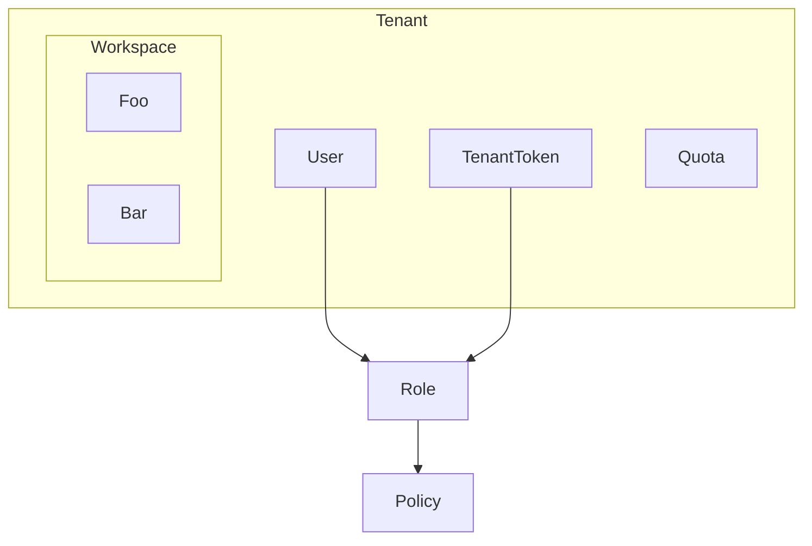
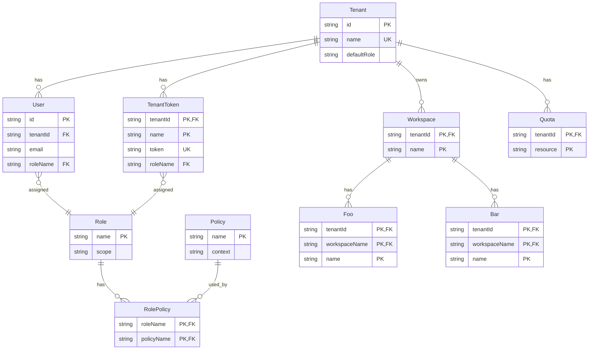

# ER 図＠RDB

## マルチテナントの場合

マルチテナントでは、`Tenant` モデルをデータ分離の境界として扱う。

`Tenant` モデルを境界として見ると、`Workspace` モデルや `Foo` モデル、`Bar` モデルは `Tenant` モデルの内側にある。

`User` モデルや `Workspace` モデルなどのテナント配下のテーブルは `tenantId` を持つ。

これにより、認可後の Read 処理を `Tenant` 単位で絞り込める。

`Workspace` モデル配下のデータも `tenantId` を含むキーで親子関係を表す。

`Role` モデルと `Policy` モデルは `User` モデルや `TenantToken` モデルに紐づけ、画面操作や API 操作の権限を表現する。

`RolePolicy` のような中間モデルを用意すると、モデル間を多対多で紐付けられる。

<table>
  <thead>
    <tr>
      <th>モデル</th>
      <th>役割</th>
    </tr>
  </thead>
  <tbody>
    <tr>
      <td><code>Tenant</code></td>
      <td>マルチテナントにおけるデータ分離の単位</td>
    </tr>
    <tr>
      <td><code>User</code></td>
      <td><code>Tenant</code> に所属する利用者。<code>Role</code> を通じて操作権限を持つ</td>
    </tr>
    <tr>
      <td><code>TenantToken</code></td>
      <td><code>Tenant</code> に紐づく API アクセス用のトークン。<code>User</code> と同様に <code>Role</code> を持つ</td>
    </tr>
    <tr>
      <td><code>Role</code></td>
      <td><code>User</code> や <code>TenantToken</code> に割り当てる権限のまとまり</td>
    </tr>
    <tr>
      <td><code>Policy</code></td>
      <td>画面や API に対する操作可否を表すルール</td>
    </tr>
    <tr>
      <td><code>RolePolicy</code></td>
      <td><code>Role</code> と <code>Policy</code> を多対多で紐づける中間モデル</td>
    </tr>
    <tr>
      <td><code>Workspace</code></td>
      <td><code>Tenant</code> 配下で業務データをまとめる作業領域</td>
    </tr>
    <tr>
      <td><code>Quota</code></td>
      <td><code>Tenant</code> ごとの利用上限</td>
    </tr>
    <tr>
      <td><code>Foo</code></td>
      <td><code>Workspace</code> 配下に作成される業務データの例 1</td>
    </tr>
    <tr>
      <td><code>Bar</code></td>
      <td><code>Workspace</code> 配下に作成される業務データの例 2</td>
    </tr>
  </tbody>
</table>

 
